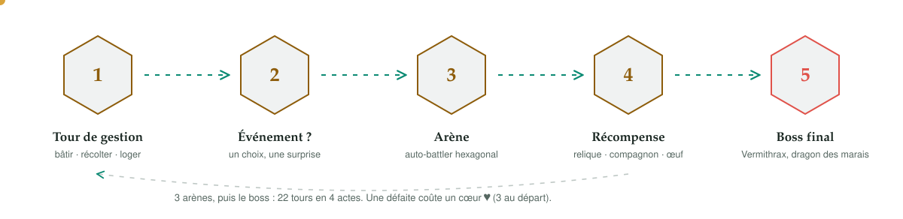
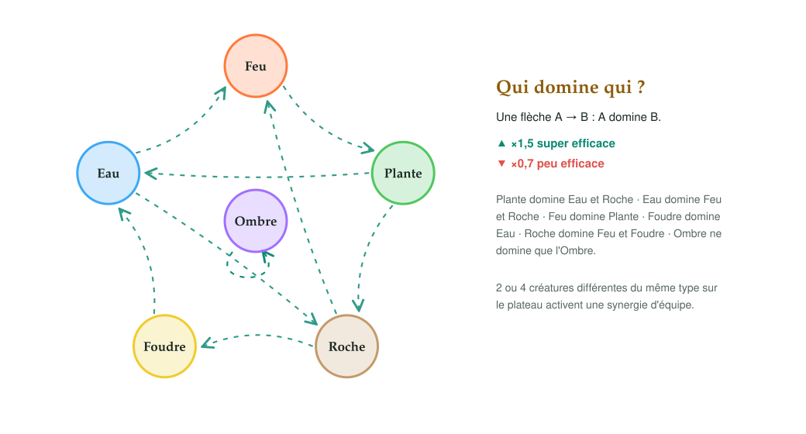

<div align="center">

<picture>
  <source media="(prefers-color-scheme: dark)" srcset="docs/assets/hero-dark.svg">
  
</picture>

[](https://github.com/M-U-C-K-A/hexaria/releases/latest)
[](https://github.com/M-U-C-K-A/hexaria/actions)


[](LICENSE)

**[Download](https://github.com/M-U-C-K-A/hexaria/releases/latest)** · **[Run it](#-run-the-game)** · [Français](README.md)

<picture>
  <source media="(prefers-color-scheme: dark)" srcset="docs/assets/divider-dark.svg">
  
</picture>

</div>

**Hexaria** is a solo roguelike for macOS that sits between three worlds:

- **Civilization**: a hexagonal island to build, buildings placed according to terrain, adjacency bonuses, builder and worker villagers;
- **Pokémon**: elemental creature types, evolutions, captures, even eggs and shiny variants;
- **TFT / Dota Auto Chess**: auto-battler arenas with a shop, rerolls, hex placement and automatic fights.

Everything is drawn in isometric 2D with a dark, glowing mood (references: Bastion, Hades). Characters, monsters, buildings and
scenery are **painted sprites** animated by the engine; the original procedural renderer is the safety net for anything that
does not have an illustration yet. The in-game text is in French.

<div align="center">

<picture>
  <source media="(prefers-color-scheme: dark)" srcset="docs/assets/features-dark.svg">
  
</picture>

</div>

## 📸 Screenshots

<table>
  <tr>
    <td width="50%"><br><sub><b>The kingdom</b>: buildings placed by terrain, progress track on top.</sub></td>
    <td width="50%"><br><sub><b>×3 zoom</b>: painted buildings, smoke, lanterns, crystal veins.</sub></td>
  </tr>
  <tr>
    <td><br><sub><b>Arena, preparation</b>: 5-card shop, bench and placement.</sub></td>
    <td><br><sub><b>Automatic fight</b>: active synergies on the left, damage meter on the right.</sub></td>
  </tr>
  <tr>
    <td><br><sub><b>Vermithrax</b>, the marsh dragon.</sub></td>
    <td><br><sub><b>Events</b>: illustration on the left, three choices on the right.</sub></td>
  </tr>
</table>

## 🚀 Run the game

**macOS app (recommended).** Download `Hexaria-0.2.0-macOS.zip` from the [latest release](https://github.com/M-U-C-K-A/hexaria/releases/latest)
(universal binary, macOS 12+), unzip, and move `Hexaria.app` to `Applications`. The app is ad-hoc signed, not notarized: on first
launch use **right-click › Open**, or run `xattr -dr com.apple.quarantine /Applications/Hexaria.app`.

**From source.**

```bash
git clone https://github.com/M-U-C-K-A/hexaria.git
cd hexaria
npm install
npm run dev          # http://localhost:5173
npm run mac          # builds build/Hexaria.app (universal, ≈ 12 MB)
```

A static web build (`Hexaria-0.2.0-web.zip`) is attached to each release too.

## 🔁 Game loop

<div align="center">

<picture>
  <source media="(prefers-color-scheme: dark)" srcset="docs/assets/loop-dark.svg">
  
</picture>

</div>

A run is **22 turns over 4 acts**: management turns, events, three arenas and a final boss. You have **3 hearts**; losing an arena
fight costs one.

1. **Kingdom.** Place buildings according to terrain (farm on plains, sawmill in forests, mine on mountains, port by the water…).
   Adjacency matters: an **Auction house next to a Port gives +5 gold**, neighbouring farms, markets next to houses…
2. **Villagers** are split between **builders** (construction points) and **workers** (a productive building without a worker is idle).
3. **Events**: a text, an illustration, three choices.
4. **Arena (auto-battler).** Your gold is your budget: about **1 min 30** to buy creatures (5-card shop, reroll for 2 gold),
   place them on your half of the board, then the fight plays out by itself. **All the gold you spent is refunded** afterwards,
   plus the victory reward.
5. **Combat buildings** (bought on the map beforehand): Barracks (+1 slot), Forge (+attack), Shrine (+HP), Academy (rarer
   creatures), Tavern (free rerolls), Menagerie (+1 companion).

## 🐾 Creatures, types and evolutions

<div align="center">

<picture>
  <source media="(prefers-color-scheme: dark)" srcset="docs/assets/types-dark.svg">
  
</picture>

</div>

Six elements; a super-effective hit deals **×1.5**, a resisted one **×0.7**. Having 2 or 4 distinct creatures of the same type on the
board triggers a team synergy. There are **15 creature lines** (3 forms each), **8 monsters**, **16 relics** and **15 events**. Three identical
copies merge into the next form (**×1.8** stats at ★2, **×3.24** at ★3).

<div align="center">

<picture>
  <source media="(prefers-color-scheme: dark)" srcset="docs/assets/evolution-dark.svg">
  
</picture>

</div>

**The little surprise:** mystery **eggs** hatch after 2-3 turns, and **shiny ✦** creatures (+20 % HP and attack) appear 1 in 8 on hatching,
6 % in the arena shop and 10 % when captured in a lair.

### Balance is measured

Each encounter has a `power` coefficient calibrated by a shop-playing bot (`scripts/balance2.ts`) with three gold budgets, aiming for a
regular difficulty curve:

<div align="center">

<picture>
  <source media="(prefers-color-scheme: dark)" srcset="docs/assets/balance-dark.svg">
  
</picture>

</div>

## 🎨 Bring your own art

Open [`art/prompts.html`](art/prompts.html) ([online preview](https://htmlpreview.github.io/?https://github.com/M-U-C-K-A/hexaria/blob/main/art/prompts.html)):
72 cards with a ready-to-copy prompt, format and exact filename for every character, monster, building, prop sheet, terrain texture,
arena backdrop, event illustration and the title screen. Save the image under `art/raw/`, run `npm run art` (white-background removal,
ground-line removal, sheet splitting, WebP, manifest) and the game picks it up. The shipped illustrations are **AI-generated**.

## ✒️ Hairline figure

The Hexaria realm redrawn as a **Hairline figure** ([`@lucasmarkes/hairline`](https://hairline.lucasmarkes.com), MIT): a hexagonal tile with a
clock tower, a colosseum and a crystal obelisk. In the interactive version the pointer picks a building, which rises while the others slide away.

<div align="center">

<picture>
  <source media="(prefers-color-scheme: dark)" srcset="docs/assets/hairline-realm-dark.svg">
  
</picture>

**[▶ Try the interactive figure](https://htmlpreview.github.io/?https://github.com/M-U-C-K-A/hexaria/blob/main/docs/hairline/hairline-realm.html)**

</div>

## 🧱 Tooling

| Command | Purpose |
| --- | --- |
| `npm run dev` / `build` / `check` | Dev server, production build, type-check |
| `npm run mac` | Universal `build/Hexaria.app` (Swift launcher + WKWebView) |
| `npx tsx scripts/balance2.ts [n]` | Bot win rates per arena and budget (`--tune` adjusts power) |
| `npm run art` | Process `art/raw/` images and regenerate the prompts page |
| `npm run shots` | Regenerate README screenshots (headless Chrome) |
| `node scripts/readme/svgs.mjs` | Regenerate the animated README SVGs |

Content lives in `src/data/` (buildings, creatures, monsters, arenas, relics, events, types); `src/game/` holds the render-free game logic
(state, map generation, economy, combat simulation), `src/render/` the drawing code and `mac/HexariaApp.swift` the native launcher.

## License

Code under the [MIT license](LICENSE). Illustrations were AI-generated for this project. See the [changelog](CHANGELOG.md).
