<div align="center">

<picture>
  <source media="(prefers-color-scheme: dark)" srcset="docs/assets/hero-dark-en.svg">
  
</picture>

[](https://github.com/M-U-C-K-A/hexaria/releases/latest)
[](https://github.com/M-U-C-K-A/hexaria/releases)
[](https://github.com/M-U-C-K-A/hexaria/actions)


[](LICENSE)

<a href="https://github.com/M-U-C-K-A/hexaria/releases/download/v0.3.0/Hexaria-0.3.0-macOS.zip"><picture><source media="(prefers-color-scheme: dark)" srcset="docs/assets/btn-macos-dark-en.svg"></picture></a>
<a href="https://github.com/M-U-C-K-A/hexaria/releases/download/v0.3.0/Hexaria-0.3.0-web.zip"><picture><source media="(prefers-color-scheme: dark)" srcset="docs/assets/btn-web-dark-en.svg"></picture></a>
<a href="https://github.com/M-U-C-K-A/hexaria/releases"><picture><source media="(prefers-color-scheme: dark)" srcset="docs/assets/btn-releases-dark-en.svg"></picture></a>

**[In action](#️-in-action)** · **[First run](#️-your-first-run)** · **[Adventure](#️-adventure-mode-difficulty-and-seeds)** · **[Kingdom](#-building-a-kingdom)** · **[Arena](#️-the-arena)** · **[Creatures](#-creatures-types-and-evolutions)** · **[Releases](#-releases)** · **[Install](#-install)** · [Français](README.md)

<picture>
  <source media="(prefers-color-scheme: dark)" srcset="docs/assets/stats-dark-en.svg">
  
</picture>

</div>

> **Hexaria** is a single-player roguelike for macOS that sits between **Civilization**, **Pokémon** and **TFT**.
> You build a hexagonal island, capture and evolve elemental creatures, then send them into auto-battler arenas.
> One run: 22 steps, 3 arenas and a dragon… then, if you want more, **adventure mode** and its endless tiers.
>
> *The game itself is in French; this page explains everything you need to play it.*

## ▶️ In action

<div align="center">

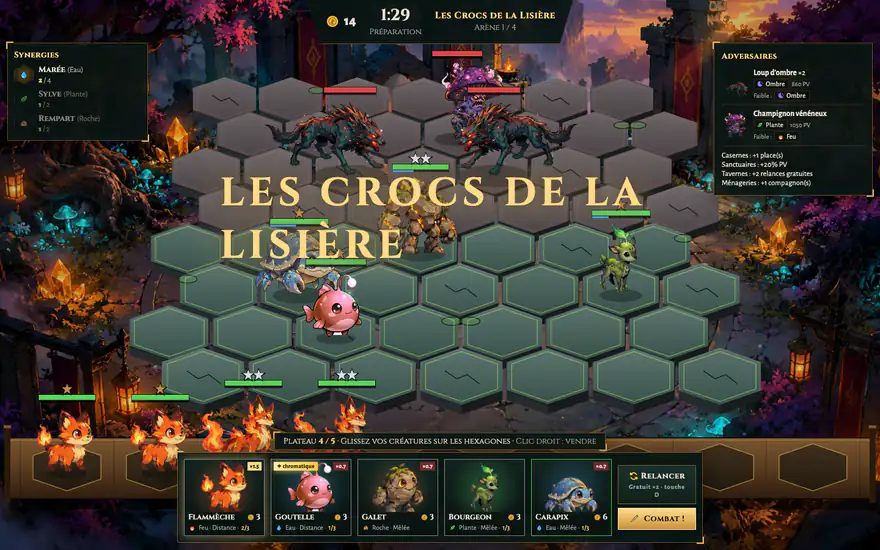

<sub><b>Arena 1, The Fangs of the Edge.</b> Buying a third Flammèche triggers a chain evolution (★ → ★★ → ★★★),
then the team deploys itself and the battle plays out: heals, "super effective", synergies, victory.</sub>

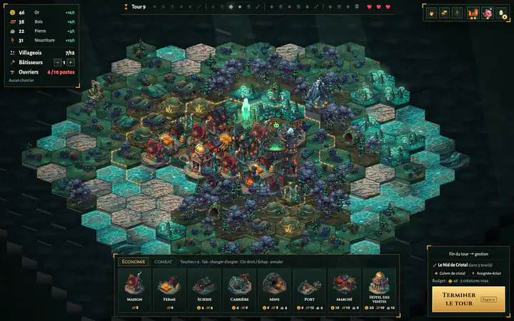

<sub><b>The kingdom, turn 9.</b> A flyover of the town: town hall, crystal obelisk, colosseum, market, forge, and the
fireflies of the glowing groves. Up to ×4.2 zoom in game.</sub>

</div>

<details>
<summary><b>Contents</b></summary>

- [In action](#️-in-action)
- [Hexaria at a glance](#-hexaria-at-a-glance)
- [Your first run](#️-your-first-run)
- [The game loop](#-the-game-loop)
- [Adventure mode, difficulty and seeds](#️-adventure-mode-difficulty-and-seeds)
- [Building a kingdom](#-building-a-kingdom)
- [The arena](#️-the-arena)
- [Creatures, types and evolutions](#-creatures-types-and-evolutions)
- [The little surprise: eggs and shinies](#-the-little-surprise-eggs-and-shinies)
- [Relics, events and achievements](#-relics-events-and-achievements)
- [Codex and options](#-codex-and-options)
- [Gallery](#-gallery)
- [Releases](#-releases)
- [Install](#-install)
- [Illustrate the game with your own AI](#-illustrate-the-game-with-your-own-ai)
- [Architecture](#-architecture)
- [The Hairline figures](#️-the-hairline-figures)
- [Controls](#-controls)
- [FAQ](#-faq)

</details>

## ✨ Hexaria at a glance

<picture>
  <source media="(prefers-color-scheme: dark)" srcset="docs/assets/features-dark-en.svg">
  
</picture>

| Borrowed from… | In Hexaria |
| --- | --- |
| **Civilization** | A hexagonal island generated for each run, terrain-dependent buildings, **adjacency bonuses**, villagers split between builders and workers. |
| **Pokémon** | 18 creature lines with **elemental types**, 3 forms each, captures in lairs, **eggs** and **shiny** variants. |
| **TFT / Dota Auto Chess** | **Auto-battler arenas**: 5-card shop, rerolls, hex placement, merging 3 copies, automatic battles. |
| **Roguelikes** | A 22-step track, 3-choice **events**, **relics**, **achievements**, 3 difficulty levels, an **adventure mode** and a different run for every seed. |

Everything is drawn in isometric 2D with a dark, glowing mood (references: Bastion, Hades). Characters, monsters,
buildings and scenery are **painted sprites** animated by the engine; the original procedural renderer is the safety net
for anything without an illustration yet.

## 🕹️ Your first run

A step-by-step guide to the first ten minutes.

<table>
  <tr>
    <td width="44%">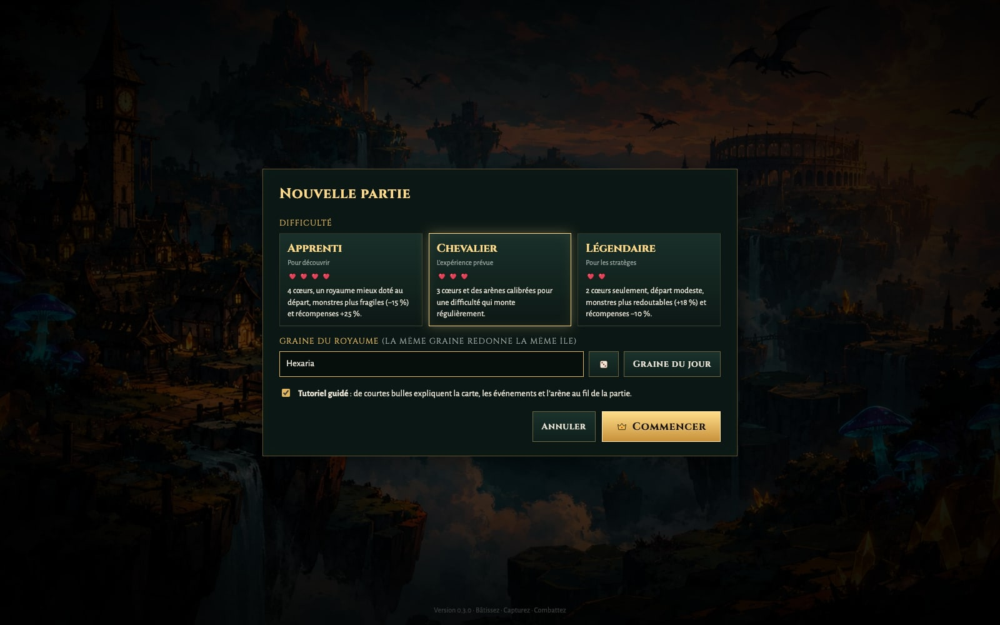</td>
    <td><b>0. Pick your run.</b> Three <b>difficulty levels</b> (Apprenti, Chevalier, Légendaire), an optional <b>seed</b>
    (the same seed gives the same island, and "Graine du jour" shares it with friends) and the <b>guided tutorial</b>
    checkbox, ticked for a first run.</td>
  </tr>
  <tr>
    <td>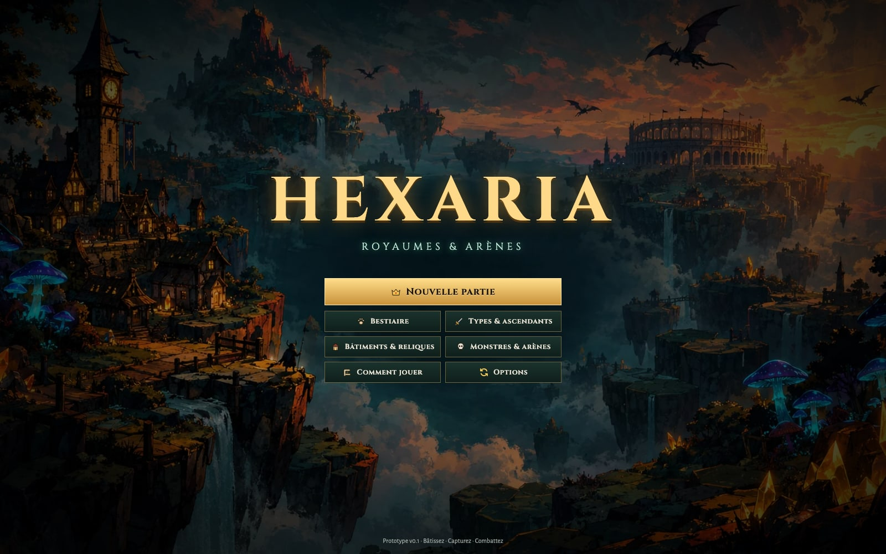</td>
    <td><b>1. New game</b> (<i>Nouvelle partie</i>). The title screen also opens the <b>guided tutorial</b>, the
    <b>Bestiary</b>, <b>Types</b>, <b>achievements</b> and <b>Options</b>. The run is saved at every step:
    <i>Continuer</i> resumes it.</td>
  </tr>
  <tr>
    <td>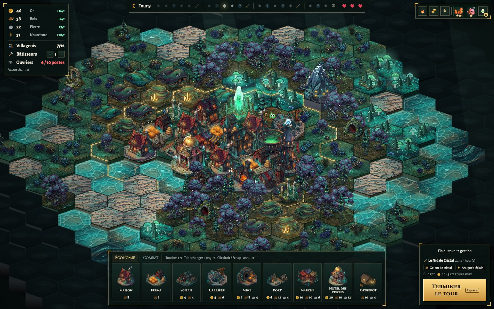</td>
    <td><b>2. Read the track at the top.</b> Each diamond is a step: management turn, event <code>?</code>, arena
    <code>⚔</code>, boss <code>☠</code>. You start with <b>15 gold, 20 wood, 8 stone, 10 food</b>, 3 villagers and
    3 hearts ♥.</td>
  </tr>
  <tr>
    <td>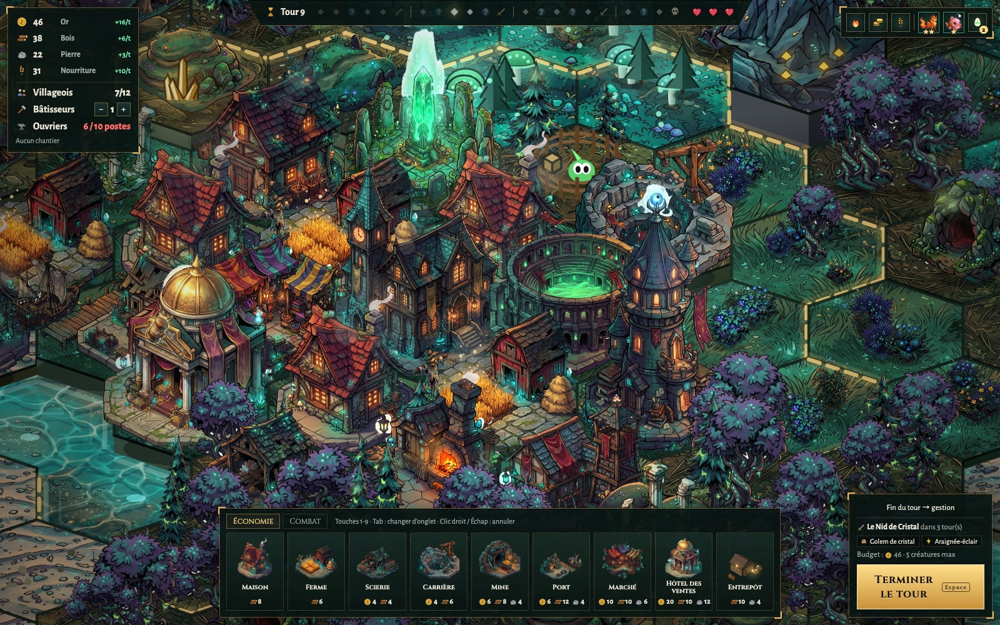</td>
    <td><b>3. Build around the town hall.</b> Pick a building in the bottom bar (keys <code>1</code>–<code>9</code>) and
    hover a tile: the tooltip shows what it would produce <b>right there</b>. A farm, a sawmill by the forest, then a
    house to grow the population. <code>Space</code> ends the turn.</td>
  </tr>
  <tr>
    <td>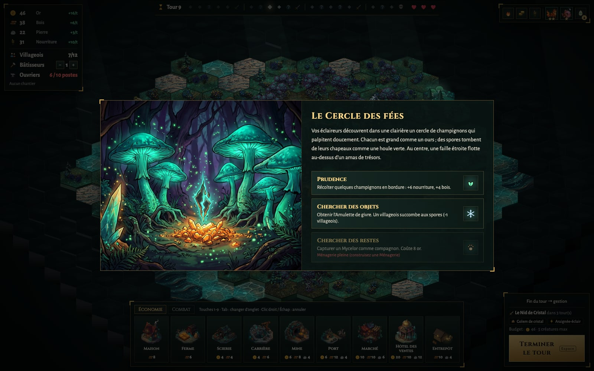</td>
    <td><b>4. Events.</b> A text, an illustration, three choices: a gamble, a trade, a relic, a capture… Some cost a
    heart. Each button spells out its effect.</td>
  </tr>
  <tr>
    <td>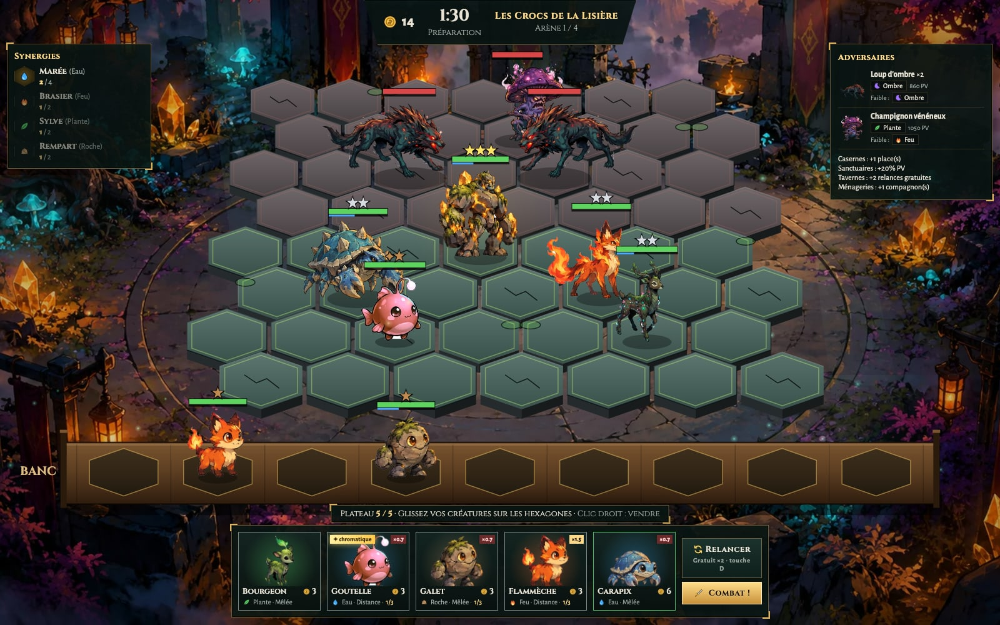</td>
    <td><b>5. The first arena.</b> Your gold becomes your budget: buy from the shop, drag creatures onto the bottom hexes
    and start the battle (<code>Space</code>). <b>All the gold you spend comes back</b> after the battle, win or lose.</td>
  </tr>
  <tr>
    <td>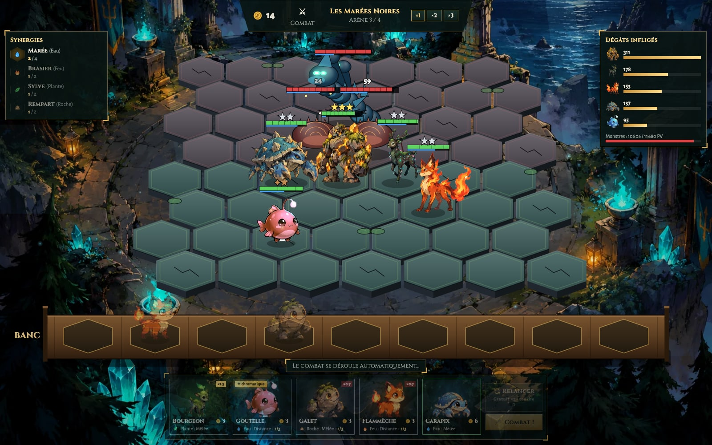</td>
    <td><b>6. Watch and learn.</b> Active synergies on the left, damage dealt on the right. A defeat costs a heart; a
    victory pays the gold reward, then lets you pick a relic, a capture or an egg.</td>
  </tr>
</table>

> [!TIP]
> Three habits that change everything: **Port + Auction house** side by side (+5 gold per turn), a **Barracks** before
> the second arena (+1 creature on the board), and **three identical creatures** for a free evolution.

### 🎓 The guided tutorial

No need to read rules: during your first run, glowing bubbles point at whatever is being explained, and some steps wait
until you do the action to move on ("**Your turn: place a building**").

<table>
  <tr>
    <td width="50%">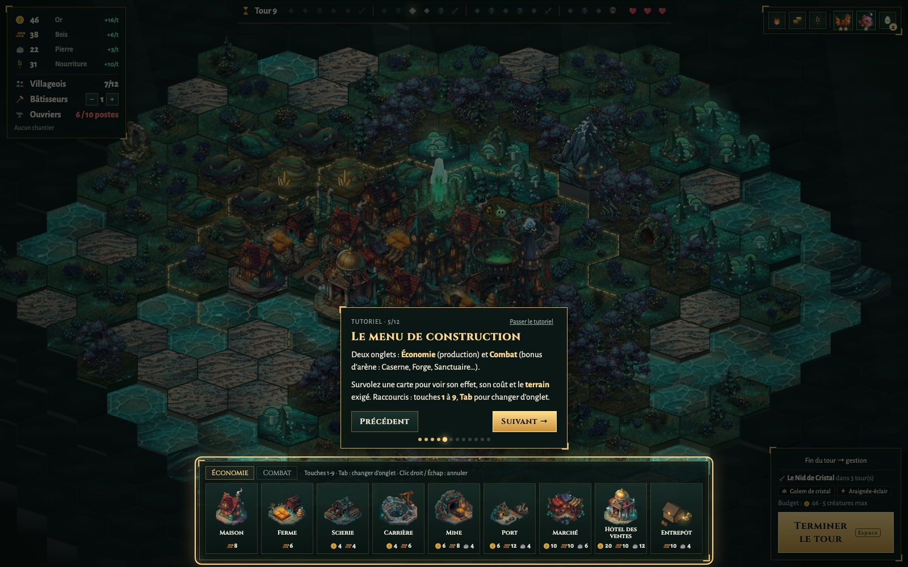<br><sub><b>"Map" chapter</b> (12 steps): resources, villagers, build menu, <i>place a first building</i>, adjacency, track, relics, <i>end the turn</i>.</sub></td>
    <td width="50%">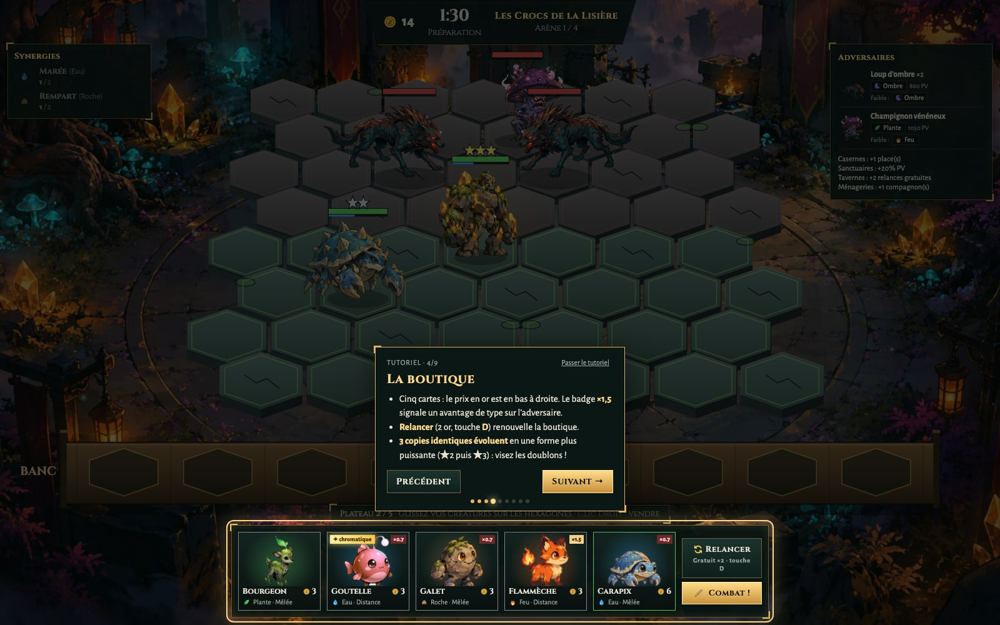<br><sub><b>"Arena" chapter</b> (9 steps): budget and time, enemies and weaknesses, shop, <i>buy</i>, <i>place</i>, synergies, <i>start the battle</i>.</sub></td>
  </tr>
</table>

Two shorter chapters complete the tour: the first **event window** and the **recap after your first battle**. `Enter` or
`→` go on, `Esc` quits. Replay it from the menu ("Tutoriel guidé") or with **⚙ Options › Rejouer le tutoriel**.

## 🔁 The game loop

<picture>
  <source media="(prefers-color-scheme: dark)" srcset="docs/assets/loop-dark-en.svg">
  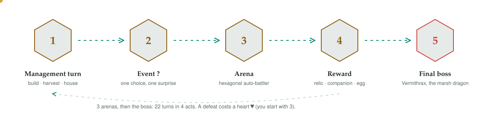
</picture>

A run lasts **22 steps over 4 acts**. Each act ends with an arena, the last one with the boss:

| Act | Steps | End of act |
| --- | --- | --- |
| I | turn · turn · `?` · turn · turn | ⚔ The Fangs of the Edge |
| II | turn · `?` · turn · turn · `?` | ⚔ The Crystal Nest |
| III | turn · `?` · turn · `?` · turn | ⚔ The Black Tides |
| IV | turn · `?` · turn | ☠ Vermithrax, the marsh dragon |

You have **3 hearts** (depending on difficulty). An arena defeat costs one, and so do some events; at zero, the run is over.

## ♾️ Adventure mode, difficulty and seeds

<picture>
  <source media="(prefers-color-scheme: dark)" srcset="docs/assets/adventure-dark-en.svg">
  
</picture>

Once **Vermithrax** is down, the run does not have to end: a window offers to **keep going**. Your kingdom, companions and
relics stay, you regain **1 heart**, and the track grows by one **tier** at a time (a few turns, an event, then a
generated arena).

<table>
  <tr>
    <td width="50%">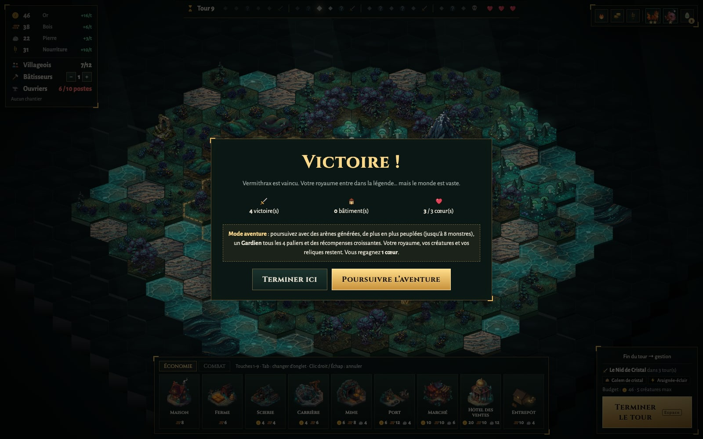<br><sub><b>After the boss</b>: end on this victory, or go on.</sub></td>
    <td width="50%">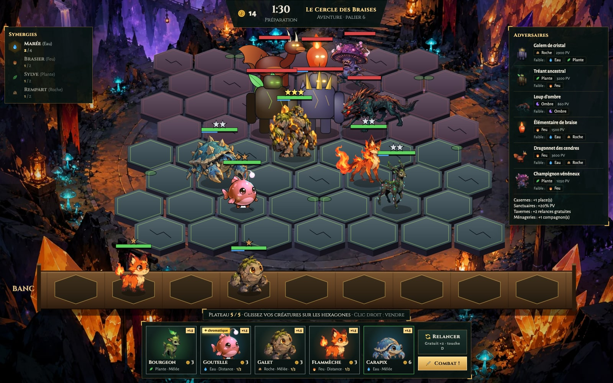<br><sub><b>Tier 6</b>: "The Circle of Embers", six monsters instead of three.</sub></td>
  </tr>
</table>

- **4 to 8 monsters** per arena, built around a dominant type, with **4 new monsters** (Storm Harpy, Ancient Treant,
  Ember Elemental, Marsh Lich).
- **A Guardian** (a champion of the dominant type, reward ×1.6) guards every fourth tier.
- Power grows **8.5% per tier**, and so do gold rewards; arenas cycle through the four scenery themes.
- No end: the adventure stops when your hearts run out. Your **best tier** is kept in the achievements.

| Difficulty | Hearts | Start (gold · wood · stone · food) | Monsters | Arena rewards |
| --- | --- | --- | --- | --- |
| **Apprenti** | 4 | 25 · 28 · 12 · 14, 4 villagers | −15% | +25% |
| **Chevalier** *(default)* | 3 | 15 · 20 · 8 · 10, 3 villagers | ×1 | ×1 |
| **Légendaire** | 2 | 12 · 16 · 6 · 8, 3 villagers | +18% | −10% |

The **seed** (a number or any word) fixes the island's geography, the lairs and the events drawn: replay it to compare
strategies, or use the **daily seed** (today's date, `YYYYMMDD`) so everyone plays the same island. It is shown on the
end-of-run screen.

## 🏰 Building a kingdom

<picture>
  <source media="(prefers-color-scheme: dark)" srcset="docs/assets/hairline-realm-dark.svg">
  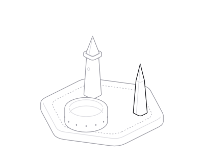
</picture>

The island is generated from a seed: plains, forests, hills, mountains, glowing groves, beaches and shallows, with gold
veins, amber crystals, fish shoals, ruins to explore and lairs of wild creatures. Unknown lands reveal themselves as the
kingdom grows.

**Four resources**: **gold** (the sinews of war, and your arena budget), **wood** and **stone** (to build), **food**
(every villager eats, the surplus grows the population).

**Villagers** are split between **builders** (they advance construction sites) and **workers** (a production building
without a worker stands idle). The left panel sets the split with `−` / `+`.

<br clear="right">

<picture>
  <source media="(prefers-color-scheme: dark)" srcset="docs/assets/adjacency-dark-en.svg">
  
</picture>

<details>
<summary><b>The 18 buildings and their effects</b></summary>

| Family | Building | Effect |
| --- | --- | --- |
| Core | **Town hall** (*Hôtel de ville*) | +3 gold, +2 food, +1 wood, +1 stone; housing +4 |
| Core | **Colosseum** (*Colisée*) | hosts arena battles |
| Economy | **House** (*Maison*) | housing +2; +1 food next to a farm |
| Economy | **Farm** (*Ferme*) | +3 food; +1 per neighbouring farm (up to +2), +1 near water |
| Economy | **Sawmill** (*Scierie*) | +2 wood; +1 per neighbouring forest (up to +3) |
| Economy | **Quarry** (*Carrière*) | +2 stone; +1 per neighbouring hill or mountain (up to +3) |
| Economy | **Mine** | +2 gold; +3 on a gold vein, +5 on crystals |
| Economy | **Port** | +2 gold, +1 food; +2 food per neighbouring fish shoal |
| Economy | **Market** (*Marché*) | +3 gold; +1 per neighbouring house (up to +3), +2 next to the town hall |
| Economy | **Auction house** (*Hôtel des ventes*) | +4 gold; **+5 next to a port**, +2 next to a market |
| Economy | **Warehouse** (*Entrepôt*) *(new)* | +1 wood, +1 stone; +1 more next to a sawmill / a quarry, +2 gold per adjacent market (up to +4) |
| Combat | **Tavern** (*Taverne*) | +2 free arena rerolls, +1 gold |
| Combat | **Barracks** (*Caserne*) | +1 creature on the board (up to 3) |
| Combat | **Forge** | +10% attack; +5% next to a mine |
| Combat | **Shrine** (*Sanctuaire*) | +12% HP; +8% on or next to a glowing grove |
| Combat | **Academy** (*Académie*) | better odds of rare creatures in the shop |
| Combat | **Menagerie** (*Ménagerie*) | +1 companion slot |
| Combat | **Observatory** (*Observatoire*) *(new)* | +15 s of preparation and +1 free reroll; on a mountain: +1 shop level (up to 2) |

</details>

## ⚔️ The arena

<picture>
  <source media="(prefers-color-scheme: dark)" srcset="docs/assets/hairline-plateau-dark.svg">
  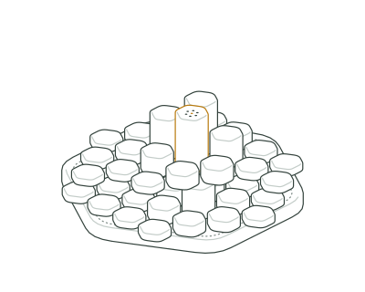
</picture>

The arena is a hexagonal board in two halves: the bottom cells are yours. The scenery changes from one arena to the next
(purple marsh, crystal cave, seashore, dragon's lair) and the mouse wheel zooms on the board.

- **Shop** of 5 cards, reroll for 2 gold (free with the Tavern), sell with right-click or `E`.
- **Bench**: the board only holds 4 creatures, plus one per Barracks.
- **Merging**: 3 identical copies become the next form, and the chain goes on up to ★★★.
- **Companions**: captured in lairs or through events, they join your bench **for free** in every arena.
- **Spells**: every creature has its ability (heal, area, shield, stun…), detailed in the Codex.

<br clear="right">

<picture>
  <source media="(prefers-color-scheme: dark)" srcset="docs/assets/economy-dark-en.svg">
  
</picture>

| Arena | Encounter | Reward |
| --- | --- | --- |
| 1 | **The Fangs of the Edge**: a pack of shadow wolves and a poisonous mushroom | 15 gold |
| 2 | **The Crystal Nest**: a colossal golem and crackling spiders | 25 gold |
| 3 | **The Black Tides**: a tide hydra and two titan crabs | 35 gold |
| 4 | **Vermithrax**: the marsh dragon and its brood, the final battle | victory |

<details>
<summary><b>Balance, measured rather than guessed</b></summary>

Each encounter has a power coefficient (`power`, in `src/data/creatures.ts`) tuned with a **shopping bot**
(`scripts/balance2.ts`) that plays the shop with three gold budgets. The goal is a steady difficulty curve instead of an
easy arena followed by a wall.

<picture>
  <source media="(prefers-color-scheme: dark)" srcset="docs/assets/balance-dark-en.svg">
  
</picture>

</details>

## 🐾 Creatures, types and evolutions

<picture>
  <source media="(prefers-color-scheme: dark)" srcset="docs/assets/parade-dark.svg">
  
</picture>

**18 lines** of three forms (Tier 1 to 4 depending on shop rarity), **12 monsters** for the arenas, the boss and the adventure.
The first 15 lines are painted; the last 3 (*) use the procedural renderer until they get their illustrations. Six
elements face off in a cycle of advantages: a **super effective** attack deals **×1.5**, a **not very effective** one
**×0.7**.

<picture>
  <source media="(prefers-color-scheme: dark)" srcset="docs/assets/types-dark-en.svg">
  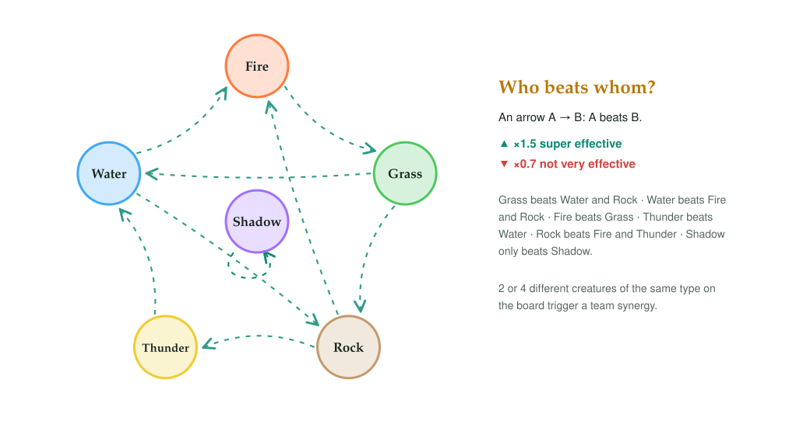
</picture>

| Element | Beats | Team synergy (2 / 4 different creatures) |
| --- | --- | --- |
| 🔥 **Fire** (*Feu*) | Grass | **Brasier** (*Blaze*): +15% / +35% damage, attacks burn |
| 💧 **Water** (*Eau*) | Fire, Rock | **Marée** (*Tide*): heals the team for 4% / 8% of max HP every 3 s |
| 🌿 **Grass** (*Plante*) | Water, Rock | **Sylve** (*Grove*): +20% / +45% max HP |
| ⚡ **Thunder** (*Foudre*) | Water | **Orage** (*Storm*): +20% / +45% attack speed |
| 🪨 **Rock** (*Roche*) | Fire, Thunder | **Rempart** (*Bulwark*): 15% / 30% damage reduction |
| 🌑 **Shadow** (*Ombre*) | Shadow | **Crépuscule** (*Twilight*): 15% / 30% lifesteal and crit |

Three identical copies merge into an evolved form: stats **×1.8** at ★★, **×3.24** at ★★★.

<picture>
  <source media="(prefers-color-scheme: dark)" srcset="docs/assets/evolution-dark.svg">
  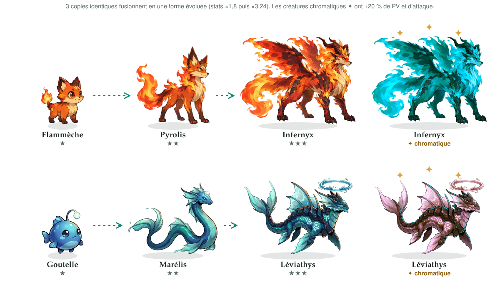
</picture>

<details>
<summary><b>The 18 lines</b></summary>

| Tier | Line (★ → ★★ → ★★★) | Element |
| --- | --- | --- |
| 1 | Flammèche → Pyrolis → Infernyx | 🔥 Fire |
| 1 | Bourgeon → Sylvanor → Ancestrel | 🌿 Grass |
| 1 | Goutelle → Marélis → Léviathys | 💧 Water |
| 1 | Galet → Rochard → Titanor | 🪨 Rock |
| 1 | Étincelle → Voltigeur → Fulgurion | ⚡ Thunder |
| 2 | Ombrelin → Spectreval → Nécrombre | 🌑 Shadow |
| 2 | Mycelor → Sporifère → Myconide-roi | 🌿 Grass |
| 2 | Carapix → Carapace → Bastiodon | 💧 Water |
| 2 | Roccotin* → Sanglocher → Mastodonte de granit | 🪨 Rock |
| 2 | Salamandre → Pyroscail → Drakéon | 🔥 Fire |
| 3 | Cristallon → Golem de quartz → Colosse prismatique | 🪨 Rock |
| 3 | Griffonerre → Tonnegriffe → Roi-tempête | ⚡ Thunder |
| 3 | Faucheur → Sombrelame → Moissonneur | 🌑 Shadow |
| 4 | Phénix → Phénix ardent → Phénix solaire | 🔥 Fire |
| 4 | Nimbulle* → Orageon → Tonnerrion | ⚡ Thunder |
| 4 | Corbelune* → Corbeau nocturne → Seigneur des corbeaux | 🌑 Shadow |
| 4 | Hydrelle → Hydre → Hydre des abysses | 💧 Water |
| 4 | Dryade → Dryade sylvestre → Reine des bois | 🌿 Grass |

</details>

## 🥚 The little surprise: eggs and shinies

<picture>
  <source media="(prefers-color-scheme: dark)" srcset="docs/assets/hairline-oeuf-dark.svg">
  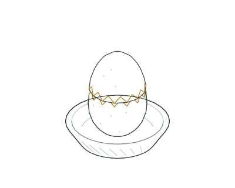
</picture>

- **Mystery eggs** (victory reward or event) hatch after 2 or 3 turns. Hatching always happens: replace a companion, or
  sell the newborn to the breeder (+12 gold).
- **Shiny** creatures ✦ with alternate colours and **+20% HP and attack**: 1 in 8 when hatching, 6% in the arena shop,
  10% when capturing in a lair.
- A shiny stays shiny when it evolves: three Goutelle including one shiny give a shiny Marélis.

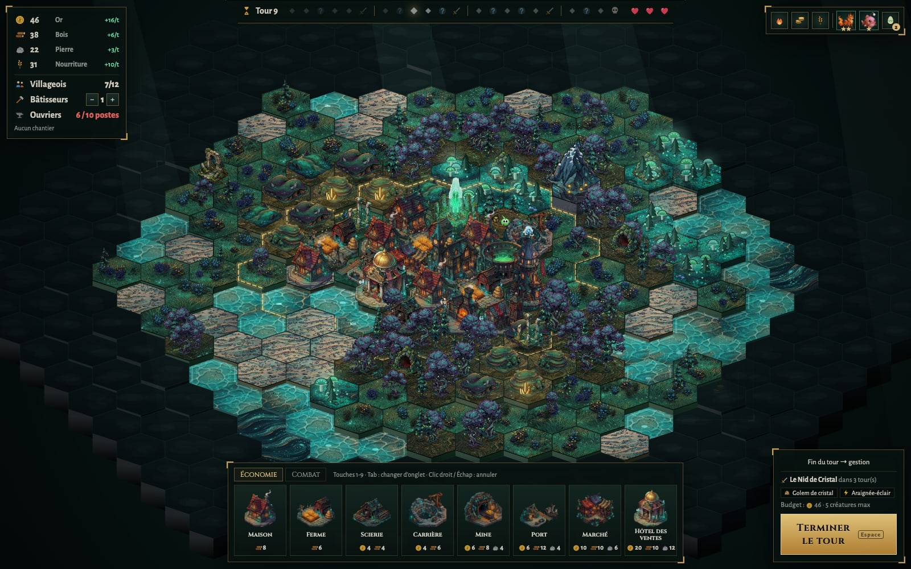

<br clear="right">

## 🎁 Relics, events and achievements

The **22 relics** give permanent bonuses for the whole run; they come from events, arena victories and travelling shops.
The **21 events** (3 choices each, with their cost and risk spelled out) range from the black market to the champion's
challenge, from the thunderstorm to the marsh oracle who reveals the monsters of the next arena.

<details>
<summary><b>The 22 relics</b></summary>

| Relic | Effect | Rarity |
| --- | --- | --- |
| **Bourse sans fond** | +20% gold produced by your buildings. | ★★ |
| **Corne d’abondance** | Every farm produces +1 food. | ★ |
| **Marteau du maître** | Every builder provides +1 construction point. | ★★ |
| **Cristal ardent** | Fire creatures: +20% damage. | ★ |
| **Écaille de léviathan** | Water creatures: +25% healing done. | ★ |
| **Totem de mousse** | Grass creatures: +20% HP. | ★ |
| **Pierre-tonnerre** | Thunder creatures: +20% attack speed. | ★ |
| **Cœur de golem** | Rock creatures: +10% damage reduction. | ★ |
| **Lame spectrale** | Shadow creatures: +20% crit. | ★ |
| **Bannière de guerre** | +1 creature on the arena board. | ★★★ |
| **Dé du destin** | +3 free rerolls per arena. | ★ |
| **Amulette de givre** | Enemies are slowed by 30% for the first 6 seconds. | ★★ |
| **Parchemin d’érudit** | Arena shop: better odds of rare creatures. | ★★ |
| **Couronne du conquérant** | +15 gold reward for every arena victory. | ★★ |
| **Élixir de vigueur** | Your creatures start the battle with 30% mana. | ★★ |
| **Œil du stratège** | +30 seconds of arena preparation and +8 arena gold. | ★ |
| **Sablier de bronze** | Eggs hatch twice as fast. | ★★ |
| **Graine d’Yggdrasil** | Shiny ✦ odds are doubled (eggs, shop, lairs). | ★★★ |
| **Épée du dresseur** | +1 companion slot. | ★★★ |
| **Bouclier de l’aube** | Your creatures start the battle with a shield worth 12% of their max HP. | ★★ |
| **Compas des cartographes** | Your territory reveals lands up to 3 tiles away instead of 2. | ★ |
| **Sceau du vampire** | Your creatures steal 8% of the damage they deal as HP. | ★★ |

</details>

<details>
<summary><b>The 21 events</b></summary>

Fairy Ring · Sunset Caravan · Shipwreck on the shore · The Mystery Egg · Rain of stars · The Shadow Altar · Harvest Festival ·
The Travelling Smith · The Wandering Trainer · The Fountain of Youth · The Sunken Library · The Sealed Tomb · The Abandoned
Camp · **The Black Market** · **The Thunderstorm** · **The Elements Shrine** · **The Children of the Woods** · **The
Champion's Challenge** · **The Marsh Oracle** · **The Giant Fossil** · **Rare Seeds** (bold: new in 0.3.0).

</details>

Your feats carry over from one run to the next: **18 achievements** (one of them secret), a record book (runs started, arenas
won, shinies found, best adventure tier…) and a 🏆 notification at every unlock.

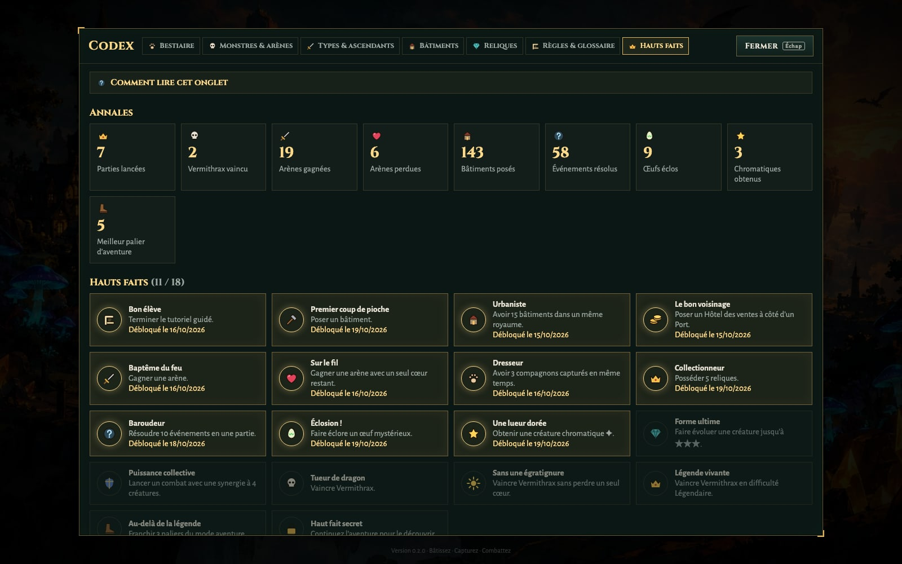

## 📖 Codex and options

<picture>
  <source media="(prefers-color-scheme: dark)" srcset="docs/assets/hairline-codex-dark.svg">
  
</picture>

The main menu opens the **Codex**, also available in game with `C` or the 📖 button: **Bestiary**, **Monsters & arenas**,
**Types** (30 × 30 matrix and comparator), **Buildings**, **Relics**, **Rules & glossary** and **Achievements**. Every
table comes with a "How to read this table" note.

**Options** (the ⚙ button in game, with "back to main menu") set the volumes, sound, default battle speed, ambient
effects, damage numbers, tooltips and the tutorial, and let you erase the save or the statistics.

<br clear="right">

<table>
  <tr>
    <td width="50%">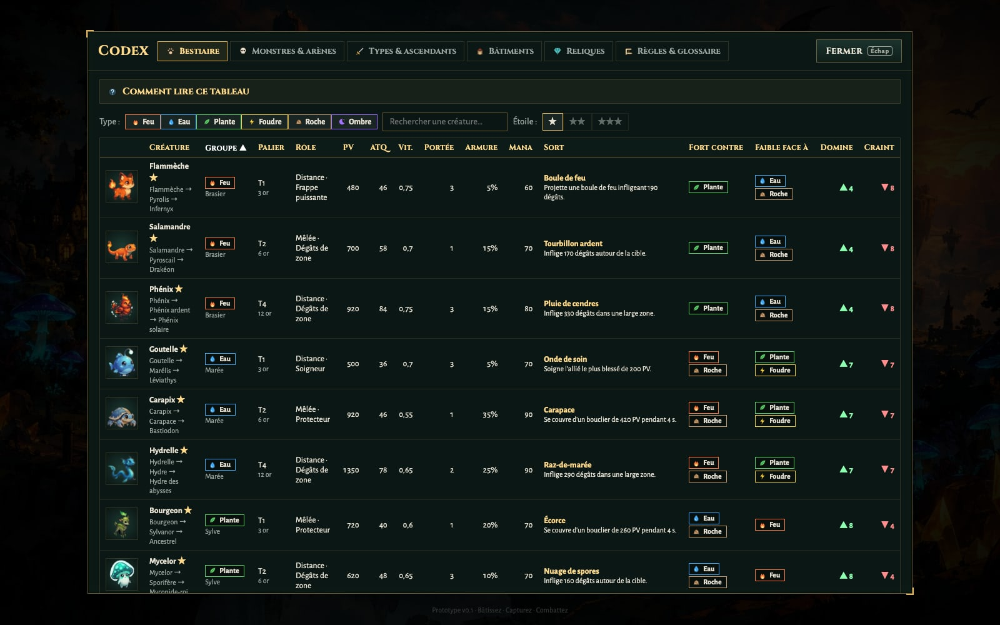<br><sub><b>Bestiary</b>: stats per star, role, spell, strengths and weaknesses.</sub></td>
    <td width="50%">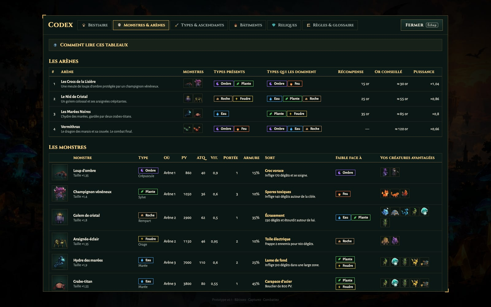<br><sub><b>Monsters & arenas</b>: who beats them, which companions fare best, suggested gold.</sub></td>
  </tr>
  <tr>
    <td>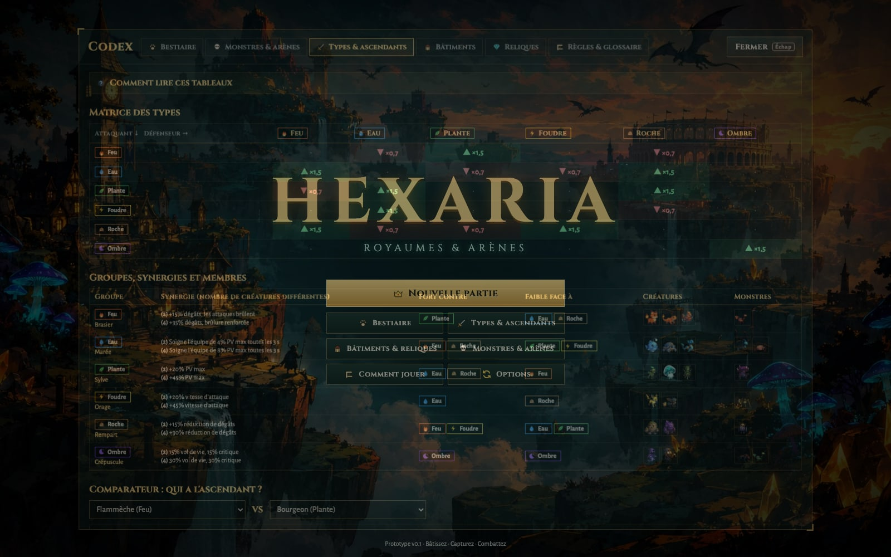<br><sub><b>Types</b>: type matrix, groups and synergies.</sub></td>
    <td>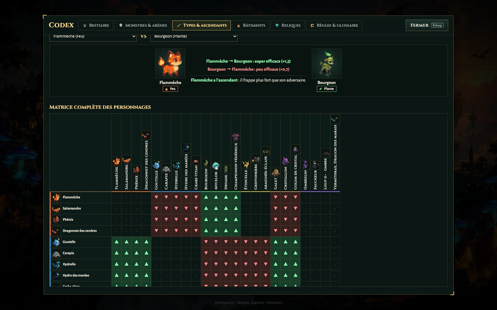<br><sub><b>Full matrix</b>, 30 × 30: who has the edge over whom, creature by creature.</sub></td>
  </tr>
</table>

## 📸 Gallery

<table>
  <tr>
    <td width="50%">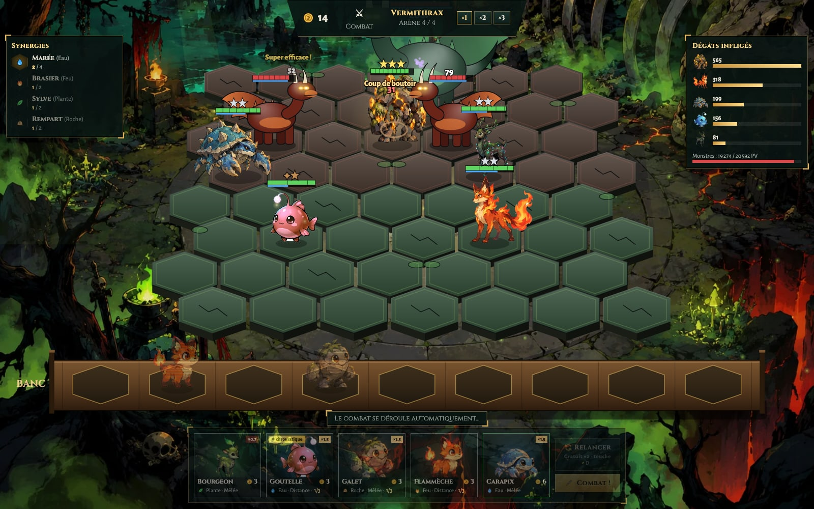<br><sub><b>Vermithrax</b>, the marsh dragon, and its brood: the final battle.</sub></td>
    <td width="50%"><br><sub><b>Automatic battle</b>: synergies on the left, damage dealt on the right, a shiny ✦ in the shop.</sub></td>
  </tr>
  <tr>
    <td><br><sub><b>The kingdom</b>: progress track, resources, tabbed build menu.</sub></td>
    <td><br><sub><b>×3 zoom</b>: painted buildings, smoke, lanterns and crystal veins.</sub></td>
  </tr>
</table>

## 🚀 Releases

| Version | Date | Highlights | Downloads |
| --- | --- | --- | --- |
| [**v0.3.0**](https://github.com/M-U-C-K-A/hexaria/releases/tag/v0.3.0) · *current* | 2026-10-19 | **Guided tutorial**, endless **adventure mode**, 3 difficulty levels and seeds, **18 achievements**, 3 lines, 4 monsters, 2 buildings, 6 relics and 8 events | [macOS](https://github.com/M-U-C-K-A/hexaria/releases/download/v0.3.0/Hexaria-0.3.0-macOS.zip) · [web](https://github.com/M-U-C-K-A/hexaria/releases/download/v0.3.0/Hexaria-0.3.0-web.zip) |
| [v0.2.0](https://github.com/M-U-C-K-A/hexaria/releases/tag/v0.2.0) | 2026-10-18 | Animated painted sprites, Codex, eggs and shinies, simulation-tuned balance, ×4.2 zoom, universal app | [macOS](https://github.com/M-U-C-K-A/hexaria/releases/download/v0.2.0/Hexaria-0.2.0-macOS.zip) · [web](https://github.com/M-U-C-K-A/hexaria/releases/download/v0.2.0/Hexaria-0.2.0-web.zip) |
| v0.1.0 · *prototype* | — | Hex map, buildings and adjacency, villagers, events, arenas, evolutions, relics, native launcher | — |

<picture>
  <source media="(prefers-color-scheme: dark)" srcset="docs/assets/roadmap-dark-en.svg">
  
</picture>

Every release is detailed in the [changelog](CHANGELOG.md) (in French). Next up: **items** to equip and **class traits**,
then Civ-style **ages** that unlock buildings and creatures. Illustrations for the last 3 lines, the 4 new monsters and
the 2 new buildings can be generated with the [prompt page](art/prompts.html).

## 📦 Install

### macOS app (recommended)

1. Download **[`Hexaria-0.3.0-macOS.zip`](https://github.com/M-U-C-K-A/hexaria/releases/download/v0.3.0/Hexaria-0.3.0-macOS.zip)**
   (universal binary: Apple silicon and Intel, macOS 12 or later, about 11 MB).
2. Unzip it and drag `Hexaria.app` into `Applications`.
3. The app is ad-hoc signed but **not notarized** by Apple. On first launch: **right-click › Open**, or:

   ```bash
   xattr -dr com.apple.quarantine /Applications/Hexaria.app
   ```

The save lives in the app's preferences (`UserDefaults`), safe from the browser cache.

### Web version (Windows, Linux, any browser)

[`Hexaria-0.3.0-web.zip`](https://github.com/M-U-C-K-A/hexaria/releases/download/v0.3.0/Hexaria-0.3.0-web.zip) holds the
static build. It must be served over HTTP (not opened with `file://`):

```bash
unzip Hexaria-0.3.0-web.zip -d hexaria-web && npx serve hexaria-web
```

### From source

```bash
git clone https://github.com/M-U-C-K-A/hexaria.git
cd hexaria
npm install
npm run dev          # http://localhost:5173
npm run mac          # builds build/Hexaria.app (universal)
```

<details>
<summary><b>All commands</b></summary>

| Command | Purpose |
| --- | --- |
| `npm run dev` | Vite dev server |
| `npm run check` | TypeScript check |
| `npm run build` | Production web build in `dist/` |
| `npm run mac` | Builds `build/Hexaria.app` (Swift + WKWebView launcher, universal) |
| `npx tsx scripts/balance2.ts [n]` | Shopping bot: win rate per arena and budget (`--tune` adjusts encounter power, `--adventure` measures adventure tiers) |
| `npm run art` | Cuts out and imports the images in `art/raw/`, regenerates `art/prompts.html` |
| `npm run shots` | Regenerates the screenshots (headless Chrome) |
| `node scripts/readme/clips.mjs` | Records the animated clips `docs/media/*.webp` (and the release MP4s) |
| `node scripts/readme/svgs.mjs` | Regenerates the README's animated SVGs (FR/EN, light/dark) |
| `node scripts/readme/hairline-svg.mjs` | Converts the Hairline figures into animated SVGs |

Dev pages (with `npm run dev`): `/?gallery` shows every creature, monster and building; `/?icon` regenerates the icon;
`/?shot=<scene>` stages the game for screenshots and clips.

</details>

## 🎨 Illustrate the game with your own AI

No image is set in stone: the game is designed to be illustrated with **any image AI**.

<picture>
  <source media="(prefers-color-scheme: dark)" srcset="docs/assets/pipeline-dark-en.svg">
  
</picture>

1. Open [`art/prompts.html`](art/prompts.html) (double-click): **81 cards** with a ready-to-copy prompt, the format, the
   suggested size and the exact file name for every character, monster, building, scenery sheet, texture, arena
   background, event illustration and title screen.
2. Generate the image with your AI on a **white background** and drop it into `art/raw/` under the given name (or drop
   it on the page while `npm run dev` runs).
3. `npm run art` removes the white background, erases ground lines, slices the sheets and writes `src/assets/art/**` as WebP.
4. The "puppet" engine (`src/render/sprites.ts`) slices each sprite into 18 bands to animate it: breathing, sway, hop,
   wind-up then lunge, hit flash, spell, stun, death.

<p align="center">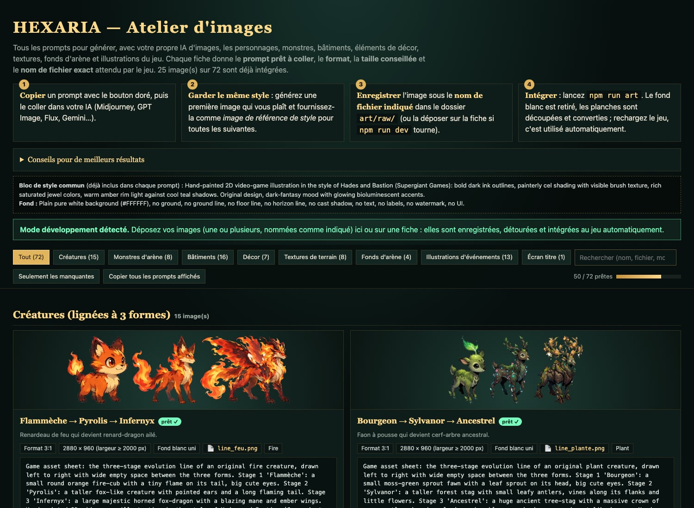</p>

> The bundled illustrations were **AI-generated** and then cut out by this pipeline. The raw images (about 120 MB) are
> not versioned: only the result lives in `src/assets/art/`.

## 🧱 Architecture

<picture>
  <source media="(prefers-color-scheme: dark)" srcset="docs/assets/architecture-dark-en.svg">
  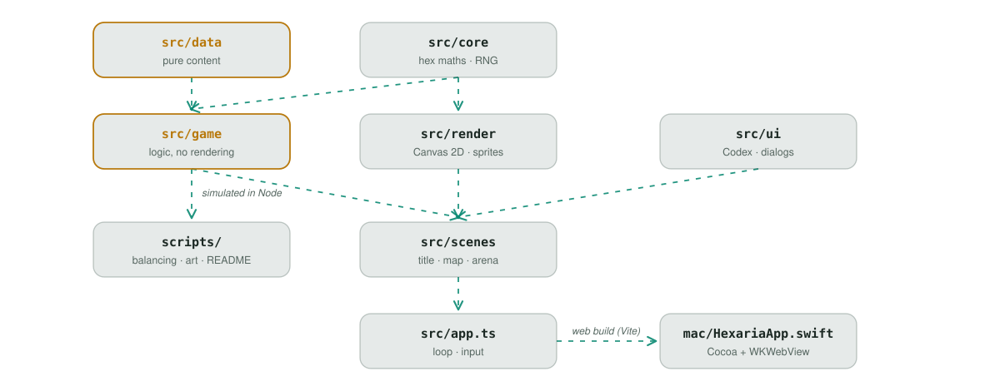
</picture>

Content is **data-driven**: adding a creature, an arena or an event in `src/data/` does not touch the engine. Battle
logic (`src/game/combat.ts`) does not depend on rendering, so thousands of battles can be simulated in Node for balancing.

<details>
<summary><b>Adding a creature in a few lines</b></summary>

```ts
// src/data/creatures.ts
{
  id: 'flammeche', names: ['Flammèche', 'Pyrolis', 'Infernyx'], tier: 1, element: 'feu',
  hp: 480, atk: 46, as: 0.75, range: 3, armor: 0.05, mana: 60,
  ability: { kind: 'nuke', name: 'Boule de feu', desc: 'Projette une boule de feu infligeant {v} dégâts.', values: [190, 320, 560] },
  look: { body: 'blob', c1: '#ff8a3d', c2: '#ffd08a', c3: '#ffef9a', parts: ['flame', 'tail'], eye: 'cute', evo: [['ears'], ['wings', 'horns']] },
},
```

The shop, the Codex, the type matrix and the balancing bot pick it up right away. Without an illustration it is drawn by
the procedural renderer from `look`; add its card to `scripts/art/promptData.ts` for the prompts page.

</details>

<details>
<summary><b>Project layout</b></summary>

```
src/
  app.ts               loop, scenes, input
  audio.ts             effects and generative music (WebAudio, no audio files)
  settings.ts          persisted options
  core/                hex maths, isometric projection, deterministic RNG
  data/                pure content: terrain, buildings, creatures, monsters, arenas, relics, events, types
  game/                logic without rendering: state and save, map generation, economy, combat
  render/              tiles, buildings, creatures, painted sprites, arena scenery, particles
  scenes/              title, world map, arena
  ui/                  Codex, event dialogs, icons, styles
  dev/shots.ts         staging for screenshots and clips (development only)
mac/HexariaApp.swift   native Cocoa + WKWebView launcher, hexaria:// scheme, UserDefaults save
scripts/               macOS build, balancing, image pipeline, README generation
art/prompts.html       image prompts page (generated)
docs/                  screenshots, clips, animated SVGs, Hairline figures
```

</details>

## ✒️ The Hairline figures

The four line drawings on this page are **[Hairline](https://hairline.lucasmarkes.com) figures** (engine
`@lucasmarkes/hairline`, MIT license): single-stroke isometric objects that answer the pointer. Here they are converted
into animated SVGs that replay a visit of the pointer; the interactive versions live in [`docs/hairline/`](docs/hairline).

| Figure | What the pointer does | Interactive |
| --- | --- | --- |
| **Realm** | picks a building, which rises while the others slide away | [open](https://htmlpreview.github.io/?https://github.com/M-U-C-K-A/hexaria/blob/main/docs/hairline/hairline-realm.html) |
| **Board** (*plateau*) | lifts the arena cells, which fall off with distance | [open](https://htmlpreview.github.io/?https://github.com/M-U-C-K-A/hexaria/blob/main/docs/hairline/hairline-plateau.html) |
| **Egg** (*œuf*) | hatches the egg as it comes closer; a creature comes out | [open](https://htmlpreview.github.io/?https://github.com/M-U-C-K-A/hexaria/blob/main/docs/hairline/hairline-oeuf.html) |
| **Codex** | stands a page up; the others fan away in turn | [open](https://htmlpreview.github.io/?https://github.com/M-U-C-K-A/hexaria/blob/main/docs/hairline/hairline-codex.html) |

The sources are `docs/hairline/<name>.js`; `scripts/readme/hairline-svg.mjs` plays each figure in Chrome on a simulated
clock and turns it into an animated SVG (SMIL, transparent background, the bright stroke in gold).

## 🎮 Controls

| Map | Arena |
| --- | --- |
| Drag: move the camera | Click a card: buy |
| Wheel: zoom (up to ×4.2) | Drag: place a creature · wheel: zoom |
| `1`–`9`: pick a building · `Tab`: switch tab | Right-click / `E`: sell |
| Right-click / `Esc`: cancel | `D`: reroll the shop |
| `Space`: end the turn | `Space`: start the battle |
| `M`: mute · `C`: Codex · ⚙: options | ×1 ×2 ×3: battle speed |
| Tutorial: `Enter` / `→` next, `Esc` quit | `Esc`: close a window |

## ❓ FAQ

<details>
<summary><b>macOS says the app "can't be opened" or comes from an unidentified developer.</b></summary>

The app is not notarized (that requires a paid Apple developer account). **Right-click › Open** it once, or remove the
quarantine attribute with `xattr -dr com.apple.quarantine /Applications/Hexaria.app`.
</details>

<details>
<summary><b>Can I play on Windows or Linux?</b></summary>

Yes, with the web version: unzip `Hexaria-0.3.0-web.zip` and serve the folder with any HTTP server (`npx serve`,
`python3 -m http.server`…). The save then lives in the browser's local storage.
</details>

<details>
<summary><b>Is the game in English?</b></summary>

Not yet: the interface and texts are in French. This page, the Codex tables and the tooltips should get you through a
first run; translations are welcome.
</details>

<details>
<summary><b>Where is my save? How do I start over?</b></summary>

In the macOS app, in the app's preferences (`UserDefaults`); in the browser, in `localStorage`. **Options › Effacer la
sauvegarde** resets everything.
</details>

<details>
<summary><b>How do I replay the tutorial?</b></summary>

From the title screen (**Tutoriel guidé**, which starts an Apprenti run with the bubbles on) or in game with **⚙ Options ›
Rejouer le tutoriel** (it restarts on your next run). The bubbles' "Passer le tutoriel" link turns it off.
</details>

<details>
<summary><b>What happens after Vermithrax? And what does the seed do?</b></summary>

A window offers to **end** the run or **keep going** (generated tiers, 4 to 8 monsters, a Guardian every 4 tiers). The
**seed** fixes the island and the draws of the run: the same seed gives the same geography.
</details>

<details>
<summary><b>Are the images AI-generated?</b></summary>

Yes, then cut out and animated by the repository's pipeline. The game stays playable without them (procedural
rendering), and `art/prompts.html` lets you regenerate each image with the AI of your choice.
</details>

<details>
<summary><b>How can I contribute?</b></summary>

Open an issue or a pull request. `npm run check` and `npm run build` must pass (that is what the CI runs). New creatures,
events and arenas all live in `src/data/`.
</details>

## License

Code under the [MIT](LICENSE) license. The illustrations were AI-generated for this project. The Hairline figures use the
[`@lucasmarkes/hairline`](https://hairline.lucasmarkes.com) engine (MIT).

<picture>
  <source media="(prefers-color-scheme: dark)" srcset="docs/assets/footer-dark-en.svg">
  
</picture>
