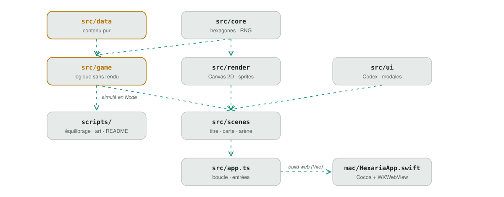

<div align="center">

<picture>
  <source media="(prefers-color-scheme: dark)" srcset="docs/assets/hero-dark.svg">
  
</picture>

[](https://github.com/M-U-C-K-A/hexaria/releases/latest)
[](https://github.com/M-U-C-K-A/hexaria/releases)
[](https://github.com/M-U-C-K-A/hexaria/actions)


[](LICENSE)

<a href="https://github.com/M-U-C-K-A/hexaria/releases/download/v0.3.0/Hexaria-0.3.0-macOS.zip"><picture><source media="(prefers-color-scheme: dark)" srcset="docs/assets/btn-macos-dark.svg"></picture></a>
<a href="https://github.com/M-U-C-K-A/hexaria/releases/download/v0.3.0/Hexaria-0.3.0-web.zip"><picture><source media="(prefers-color-scheme: dark)" srcset="docs/assets/btn-web-dark.svg"></picture></a>
<a href="https://github.com/M-U-C-K-A/hexaria/releases"><picture><source media="(prefers-color-scheme: dark)" srcset="docs/assets/btn-releases-dark.svg"></picture></a>

**[En action](#️-en-action)** · **[Première partie](#️-votre-première-partie)** · **[Aventure](#️-mode-aventure-difficultés-et-graines)** · **[Royaume](#-bâtir-un-royaume)** · **[Arène](#️-larène)** · **[Créatures](#-créatures-types-et-évolutions)** · **[Versions](#-versions)** · **[Installer](#-installer)** · [English](README.en.md)

<picture>
  <source media="(prefers-color-scheme: dark)" srcset="docs/assets/stats-dark.svg">
  
</picture>

</div>

> **Hexaria** est un roguelike solo pour macOS à mi-chemin entre **Civilization**, **Pokémon** et **TFT**.
> Vous bâtissez une île hexagonale, vous capturez et faites évoluer des créatures élémentaires, puis vous les envoyez
> dans des arènes d'auto-battler. Une partie : 22 étapes, 3 arènes et un dragon… puis, si vous en voulez encore,
> le **mode aventure** et ses paliers sans fin.

## ▶️ En action

<div align="center">


<sub><b>Arène 1, Les Crocs de la Lisière.</b> Acheter une troisième Flammèche déclenche une évolution en chaîne (★ → ★★ → ★★★),
puis l'équipe se place toute seule et le combat se joue : soins, « super efficace », synergies, victoire.</sub>


<sub><b>Le royaume, tour 9.</b> Survol de la ville : hôtel de ville, obélisque de cristal, colisée, marché, forge, et les
lucioles des bosquets. Zoom jusqu'à ×4,2 en jeu.</sub>

</div>

<details>
<summary><b>Sommaire</b></summary>

- [En action](#️-en-action)
- [Hexaria en bref](#-hexaria-en-bref)
- [Votre première partie](#️-votre-première-partie)
- [La boucle de jeu](#-la-boucle-de-jeu)
- [Mode aventure, difficultés et graines](#️-mode-aventure-difficultés-et-graines)
- [Bâtir un royaume](#-bâtir-un-royaume)
- [L'arène](#️-larène)
- [Créatures, types et évolutions](#-créatures-types-et-évolutions)
- [La petite surprise : œufs et chromatiques](#-la-petite-surprise--œufs-et-chromatiques)
- [Reliques, événements et hauts faits](#-reliques-événements-et-hauts-faits)
- [Codex et options](#-codex-et-options)
- [Galerie](#-galerie)
- [Versions](#-versions)
- [Installer](#-installer)
- [Illustrer le jeu avec sa propre IA](#-illustrer-le-jeu-avec-sa-propre-ia)
- [Architecture](#-architecture)
- [Les figures Hairline](#️-les-figures-hairline)
- [Commandes](#-commandes)
- [FAQ](#-faq)

</details>

## ✨ Hexaria en bref

<picture>
  <source media="(prefers-color-scheme: dark)" srcset="docs/assets/features-dark.svg">
  
</picture>

| Emprunté à… | Dans Hexaria |
| --- | --- |
| **Civilization** | Une île hexagonale générée à chaque partie, des bâtiments qui dépendent du terrain, des **bonus d'adjacence**, des villageois répartis entre bâtisseurs et ouvriers. |
| **Pokémon** | 18 lignées de créatures à **types élémentaires**, 3 formes chacune, des captures dans les repaires, des **œufs** et des variantes **chromatiques**. |
| **TFT / Dota Auto Chess** | Des **arènes d'auto-battler** : boutique de 5, relances, placement sur les hexagones, fusion de 3 exemplaires, combat automatique. |
| **Les roguelikes** | Une piste de 22 étapes, des **événements** à 3 choix, des **reliques**, des **hauts faits**, 3 niveaux de difficulté, un **mode aventure** et une partie différente à chaque graine. |

Tout est dessiné en 2D isométrique dans une ambiance sombre et luminescente (références : Bastion, Hades). Personnages,
monstres, bâtiments et décors sont des **sprites peints** animés par le moteur ; le rendu procédural d'origine sert de
filet de sécurité pour ce qui n'a pas encore d'illustration.

## 🕹️ Votre première partie

Un guide pas à pas pour les dix premières minutes.

<table>
  <tr>
    <td width="44%"></td>
    <td><b>0. Choisissez votre partie.</b> Trois <b>difficultés</b> (Apprenti, Chevalier, Légendaire), une <b>graine</b>
    optionnelle (la même graine redonne la même île, et « Graine du jour » la partage entre amis) et la case
    <b>Tutoriel guidé</b>, cochée pour une première partie.</td>
  </tr>
  <tr>
    <td></td>
    <td><b>1. Nouvelle partie.</b> L'écran titre propose aussi le <b>Tutoriel guidé</b>, le <b>Bestiaire</b>, les
    <b>Types & ascendants</b>, les <b>Hauts faits</b> et les <b>Options</b>. La partie est sauvegardée à chaque étape :
    « Continuer » la reprend.</td>
  </tr>
  <tr>
    <td></td>
    <td><b>2. Lisez la piste en haut.</b> Chaque losange est une étape : tour de gestion, événement <code>?</code>,
    arène <code>⚔</code>, boss <code>☠</code>. Vous commencez avec <b>15 or, 20 bois, 8 pierre, 10 nourriture</b>,
    3 villageois et 3 cœurs ♥.</td>
  </tr>
  <tr>
    <td></td>
    <td><b>3. Construisez près de l'hôtel de ville.</b> Choisissez un bâtiment dans la barre du bas (touches <code>1</code>–<code>9</code>),
    survolez une case : l'aperçu affiche ce qu'il produira <b>à cet endroit</b>. Une ferme, une scierie au bord de la forêt,
    puis une maison pour loger plus de monde. <code>Espace</code> termine le tour.</td>
  </tr>
  <tr>
    <td></td>
    <td><b>4. Les événements.</b> Un texte, une illustration, trois choix : un pari, un échange, une relique, une capture…
    Certains coûtent un cœur. Lisez les effets en bas de chaque bouton avant de choisir.</td>
  </tr>
  <tr>
    <td></td>
    <td><b>5. La première arène.</b> Votre or devient votre budget : achetez dans la boutique, glissez les créatures sur
    les hexagones du bas, et lancez le combat (<code>Espace</code>). <b>Tout l'or dépensé vous est rendu</b> après le combat,
    victoire ou non.</td>
  </tr>
  <tr>
    <td></td>
    <td><b>6. Regardez et apprenez.</b> Les synergies actives sont à gauche, les dégâts infligés à droite. Une défaite
    coûte un cœur ; une victoire rapporte la récompense en or, puis au choix une relique, une capture ou un œuf.</td>
  </tr>
</table>

> [!TIP]
> Trois réflexes qui changent tout : **Port + Hôtel des ventes** côte à côte (+5 or par tour), une **Caserne** avant la
> deuxième arène (+1 créature sur le plateau), et **trois créatures identiques** pour une évolution gratuite.

### 🎓 Le tutoriel guidé

Pas besoin de lire une règle : au fil de la première partie, des bulles lumineuses désignent l'élément expliqué et
certaines étapes attendent que vous fassiez l'action pour avancer (« **À vous : posez un bâtiment** »).

<table>
  <tr>
    <td width="50%"><br><sub><b>Chapitre « carte »</b> (12 étapes) : ressources, villageois, menu de construction, <i>poser un premier bâtiment</i>, adjacences, piste, reliques, <i>terminer le tour</i>.</sub></td>
    <td width="50%"><br><sub><b>Chapitre « arène »</b> (9 étapes) : budget et temps, adversaires et faiblesses, boutique, <i>acheter</i>, <i>placer</i>, synergies, <i>lancer le combat</i>.</sub></td>
  </tr>
</table>

Deux chapitres plus courts complètent le parcours : la première **fenêtre d'événement** et le **bilan du premier combat**.
`Entrée` ou `→` avancent, `Échap` quitte. Le tutoriel se **rejoue** depuis le menu (« Tutoriel guidé ») ou **⚙ Options ›
Rejouer le tutoriel**.

## 🔁 La boucle de jeu

<picture>
  <source media="(prefers-color-scheme: dark)" srcset="docs/assets/loop-dark.svg">
  
</picture>

Une partie dure **22 étapes réparties en 4 actes**. Chaque acte se termine par une arène, le dernier par le boss :

| Acte | Étapes | Fin d'acte |
| --- | --- | --- |
| I | gestion · gestion · `?` · gestion · gestion | ⚔ Les Crocs de la Lisière |
| II | gestion · `?` · gestion · gestion · `?` | ⚔ Le Nid de Cristal |
| III | gestion · `?` · gestion · `?` · gestion | ⚔ Les Marées Noires |
| IV | gestion · `?` · gestion | ☠ Vermithrax, le dragon des marais |

Vous avez **3 cœurs** (selon la difficulté). Une défaite en arène en coûte un, certains événements aussi ; à zéro, la partie s'arrête.

## ♾️ Mode aventure, difficultés et graines

<picture>
  <source media="(prefers-color-scheme: dark)" srcset="docs/assets/adventure-dark.svg">
  
</picture>

Une fois **Vermithrax** vaincu, la partie ne s'arrête pas forcément : une fenêtre propose de **poursuivre l'aventure**.
Votre royaume, vos compagnons et vos reliques restent, vous regagnez **1 cœur**, et la piste s'allonge d'un **palier** à la
fois (quelques tours, un événement, puis une arène générée).

<table>
  <tr>
    <td width="50%"><br><sub><b>Après le boss</b> : terminer sur cette victoire, ou poursuivre.</sub></td>
    <td width="50%"><br><sub><b>Palier 6</b> : « Le Cercle des Braises », six monstres au lieu de trois.</sub></td>
  </tr>
</table>

- **De 4 à 8 monstres** par arène, choisis autour d'un type dominant, avec **4 nouveaux monstres** (Harpie de tempête,
  Tréant ancestral, Élémentaire de braise, Liche des marais).
- **Un Gardien** (un champion du type dominant, récompense ×1,6) garde chaque quatrième palier.
- La puissance monte de **8,5 % par palier**, les récompenses en or aussi ; les arènes font tourner les quatre décors.
- Pas de fin : l'aventure s'arrête quand vos cœurs sont épuisés. Votre **meilleur palier** est conservé dans les Hauts faits.

| Difficulté | Cœurs | Départ (or · bois · pierre · nourriture) | Monstres | Récompenses d'arène |
| --- | --- | --- | --- | --- |
| **Apprenti** | 4 | 25 · 28 · 12 · 14, 4 villageois | −15 % | +25 % |
| **Chevalier** *(par défaut)* | 3 | 15 · 20 · 8 · 10, 3 villageois | ×1 | ×1 |
| **Légendaire** | 2 | 12 · 16 · 6 · 8, 3 villageois | +18 % | −10 % |

La **graine** (un nombre ou n'importe quel mot) fixe la géographie de l'île, les repaires et les événements tirés :
rejouez-la pour comparer vos stratégies, ou lancez la **graine du jour** (la date, `AAAAMMJJ`) pour que tout le monde
joue la même île. Elle s'affiche à l'écran de fin de partie.

## 🏰 Bâtir un royaume

<picture>
  <source media="(prefers-color-scheme: dark)" srcset="docs/assets/hairline-realm-dark.svg">
  
</picture>

L'île est générée à partir d'une graine : prairies, forêts, collines, montagnes, bosquets lumineux, grèves et littoral,
avec des filons d'or, des cristaux d'ambre, des bancs de poissons, des ruines à explorer et des repaires de créatures
sauvages. Les terres inconnues se dévoilent à mesure que le royaume s'étend.

**Quatre ressources** : l'**or** (le nerf de la guerre, et votre budget d'arène), le **bois** et la **pierre** (pour
construire), la **nourriture** (chaque villageois en mange, l'excédent fait croître la population).

**Les villageois** se répartissent entre **bâtisseurs** (ils font avancer les chantiers) et **ouvriers** (un bâtiment
productif sans ouvrier est à l'arrêt). Le panneau de gauche règle la répartition avec `−` / `+`.

<br clear="right">

<picture>
  <source media="(prefers-color-scheme: dark)" srcset="docs/assets/adjacency-dark.svg">
  
</picture>

<details>
<summary><b>Les 18 bâtiments et leurs effets</b></summary>

| Famille | Bâtiment | Effet |
| --- | --- | --- |
| Cœur | **Hôtel de ville** | +3 or, +2 nourriture, +1 bois, +1 pierre ; logement +4 |
| Cœur | **Colisée** | accueille les combats d'arène |
| Économie | **Maison** | logement +2 ; +1 nourriture près d'une ferme |
| Économie | **Ferme** | +3 nourriture ; +1 par ferme voisine (max +2), +1 près de l'eau |
| Économie | **Scierie** | +2 bois ; +1 par forêt voisine (max +3) |
| Économie | **Carrière** | +2 pierre ; +1 par colline ou montagne voisine (max +3) |
| Économie | **Mine** | +2 or ; +3 sur filon d'or, +5 sur cristaux |
| Économie | **Port** | +2 or, +1 nourriture ; +2 nourriture par banc de poissons voisin |
| Économie | **Marché** | +3 or ; +1 par maison voisine (max +3), +2 près de l'hôtel de ville |
| Économie | **Hôtel des ventes** | +4 or ; **+5 à côté d'un port**, +2 à côté d'un marché |
| Économie | **Entrepôt** *(nouveau)* | +1 bois, +1 pierre ; +1 à côté d'une scierie / d'une carrière, +2 or par marché adjacent (max +4) |
| Combat | **Taverne** | +2 relances gratuites en arène, +1 or |
| Combat | **Caserne** | +1 créature sur le plateau (max 3) |
| Combat | **Forge** | +10 % d'attaque ; +5 % à côté d'une mine |
| Combat | **Sanctuaire** | +12 % de PV ; +8 % sur ou près d'un bosquet lumineux |
| Combat | **Académie** | de meilleures chances de créatures rares en boutique |
| Combat | **Ménagerie** | +1 emplacement de compagnon |
| Combat | **Observatoire** *(nouveau)* | +15 s de préparation et +1 relance gratuite ; sur une montagne : +1 niveau de boutique (max 2) |

</details>

## ⚔️ L'arène

<picture>
  <source media="(prefers-color-scheme: dark)" srcset="docs/assets/hairline-plateau-dark.svg">
  
</picture>

L'arène est un plateau hexagonal en deux moitiés : à vous les cases du bas. Le décor change d'une arène à l'autre (marais
violet, grotte de cristal, bord de mer, antre du dragon) et la molette zoome sur le plateau.

- **Boutique** de 5 cartes, relance à 2 or (gratuite avec la Taverne), vente au clic droit ou avec `E`.
- **Banc** de réserve : le plateau n'accueille que 4 créatures, plus une par Caserne.
- **Fusion** : 3 exemplaires identiques deviennent la forme suivante, et la chaîne continue jusqu'à ★★★.
- **Compagnons** : capturés dans les repaires ou par événement, ils rejoignent le banc **gratuitement** à chaque arène.
- **Sorts** : chaque créature a sa capacité (soin, zone, bouclier, étourdissement…), détaillée dans le Codex.

<br clear="right">

<picture>
  <source media="(prefers-color-scheme: dark)" srcset="docs/assets/economy-dark.svg">
  
</picture>

| Arène | Rencontre | Récompense |
| --- | --- | --- |
| 1 | **Les Crocs de la Lisière** : meute de loups d'ombre et champignon vénéneux | 15 or |
| 2 | **Le Nid de Cristal** : golem colossal et araignées crépitantes | 25 or |
| 3 | **Les Marées Noires** : hydre des marées et deux crabes-titans | 35 or |
| 4 | **Vermithrax** : dragon des marais et sa couvée, combat final | la victoire |

<details>
<summary><b>Équilibrage mesuré, pas deviné</b></summary>

Chaque rencontre a un coefficient de puissance (`power`, dans `src/data/creatures.ts`) calibré avec un **robot acheteur**
(`scripts/balance2.ts`) qui joue la boutique avec trois budgets d'or. Objectif : une courbe de difficulté régulière plutôt
qu'une arène facile suivie d'un mur.

<picture>
  <source media="(prefers-color-scheme: dark)" srcset="docs/assets/balance-dark.svg">
  
</picture>

</details>

## 🐾 Créatures, types et évolutions

<picture>
  <source media="(prefers-color-scheme: dark)" srcset="docs/assets/parade-dark.svg">
  
</picture>

**18 lignées** de trois formes (de Tier 1 à 4 selon la rareté en boutique), **12 monstres** pour les arènes, le boss et l'aventure.
Les 15 premières lignées sont peintes ; les 3 dernières (*) utilisent le rendu procédural en attendant leurs illustrations.
Six éléments s'affrontent dans un cycle d'ascendants : une attaque **super efficace** inflige **×1,5**, une attaque
**peu efficace** **×0,7**.

<picture>
  <source media="(prefers-color-scheme: dark)" srcset="docs/assets/types-dark.svg">
  
</picture>

| Élément | Domine | Synergie d'équipe (2 / 4 créatures distinctes) |
| --- | --- | --- |
| 🔥 **Feu** | Plante | **Brasier** : +15 % / +35 % de dégâts, les attaques brûlent |
| 💧 **Eau** | Feu, Roche | **Marée** : soigne l'équipe de 4 % / 8 % des PV max toutes les 3 s |
| 🌿 **Plante** | Eau, Roche | **Sylve** : +20 % / +45 % de PV max |
| ⚡ **Foudre** | Eau | **Orage** : +20 % / +45 % de vitesse d'attaque |
| 🪨 **Roche** | Feu, Foudre | **Rempart** : 15 % / 30 % de réduction de dégâts |
| 🌑 **Ombre** | Ombre | **Crépuscule** : vol de vie et critique de 15 % / 30 % |

Trois exemplaires identiques fusionnent en une forme évoluée : stats **×1,8** en ★★, **×3,24** en ★★★.

<picture>
  <source media="(prefers-color-scheme: dark)" srcset="docs/assets/evolution-dark.svg">
  
</picture>

<details>
<summary><b>Les 18 lignées</b></summary>

| Tier | Lignée (★ → ★★ → ★★★) | Élément |
| --- | --- | --- |
| 1 | Flammèche → Pyrolis → Infernyx | 🔥 Feu |
| 1 | Bourgeon → Sylvanor → Ancestrel | 🌿 Plante |
| 1 | Goutelle → Marélis → Léviathys | 💧 Eau |
| 1 | Galet → Rochard → Titanor | 🪨 Roche |
| 1 | Étincelle → Voltigeur → Fulgurion | ⚡ Foudre |
| 2 | Ombrelin → Spectreval → Nécrombre | 🌑 Ombre |
| 2 | Mycelor → Sporifère → Myconide-roi | 🌿 Plante |
| 2 | Carapix → Carapace → Bastiodon | 💧 Eau |
| 2 | Roccotin* → Sanglocher → Mastodonte de granit | 🪨 Roche |
| 2 | Salamandre → Pyroscail → Drakéon | 🔥 Feu |
| 3 | Cristallon → Golem de quartz → Colosse prismatique | 🪨 Roche |
| 3 | Griffonerre → Tonnegriffe → Roi-tempête | ⚡ Foudre |
| 3 | Faucheur → Sombrelame → Moissonneur | 🌑 Ombre |
| 4 | Phénix → Phénix ardent → Phénix solaire | 🔥 Feu |
| 4 | Nimbulle* → Orageon → Tonnerrion | ⚡ Foudre |
| 4 | Corbelune* → Corbeau nocturne → Seigneur des corbeaux | 🌑 Ombre |
| 4 | Hydrelle → Hydre → Hydre des abysses | 💧 Eau |
| 4 | Dryade → Dryade sylvestre → Reine des bois | 🌿 Plante |

</details>

## 🥚 La petite surprise : œufs et chromatiques

<picture>
  <source media="(prefers-color-scheme: dark)" srcset="docs/assets/hairline-oeuf-dark.svg">
  
</picture>

- Des **œufs mystérieux** (récompense de victoire ou événement) éclosent après 2 à 3 tours. L'éclosion a toujours lieu :
  on remplace un compagnon, ou on vend le nouveau-né à l'éleveur (+12 or).
- Des créatures **chromatiques** ✦ aux couleurs alternatives, avec **+20 % de PV et d'attaque** : 1 chance sur 8 à
  l'éclosion, 6 % en boutique d'arène, 10 % à la capture dans un repaire.
- Une chromatique le reste en évoluant : trois Goutelle dont une chromatique donnent une Marélis chromatique.


<br clear="right">

## 🎁 Reliques, événements et hauts faits

Les **22 reliques** donnent des bonus permanents pour toute la partie ; elles viennent des événements, des victoires
d'arène et des boutiques ambulantes. Les **21 événements** (3 choix chacun, avec leur coût et leur risque affichés)
vont du marché noir au défi du champion, de la tempête de foudre à l'oracle des marais qui révèle les monstres de la
prochaine arène.

<details>
<summary><b>Les 22 reliques</b></summary>

| Relique | Effet | Rareté |
| --- | --- | --- |
| **Bourse sans fond** | +20% d’or produit par vos bâtiments. | ★★ |
| **Corne d’abondance** | Chaque ferme produit +1 nourriture. | ★ |
| **Marteau du maître** | Chaque bâtisseur fournit +1 point de construction. | ★★ |
| **Cristal ardent** | Créatures Feu : +20% dégâts. | ★ |
| **Écaille de léviathan** | Créatures Eau : +25% soins prodigués. | ★ |
| **Totem de mousse** | Créatures Plante : +20% PV. | ★ |
| **Pierre-tonnerre** | Créatures Foudre : +20% vitesse d’attaque. | ★ |
| **Cœur de golem** | Créatures Roche : +10% réduction de dégâts. | ★ |
| **Lame spectrale** | Créatures Ombre : +20% critique. | ★ |
| **Bannière de guerre** | +1 créature sur le plateau d’arène. | ★★★ |
| **Dé du destin** | +3 rafraîchissements gratuits par arène. | ★ |
| **Amulette de givre** | Les ennemis sont ralentis de 30% pendant les 6 premières secondes. | ★★ |
| **Parchemin d’érudit** | Boutique d’arène : chances de créatures rares améliorées. | ★★ |
| **Couronne du conquérant** | +15 or de récompense à chaque victoire d’arène. | ★★ |
| **Élixir de vigueur** | Vos créatures commencent le combat avec 30% de mana. | ★★ |
| **Œil du stratège** | +30 secondes de préparation en arène et +8 or d’arène. | ★ |
| **Sablier de bronze** | Les œufs éclosent deux fois plus vite. | ★★ |
| **Graine d’Yggdrasil** | Les chances de créature chromatique ✦ sont doublées (œufs, boutique, repaires). | ★★★ |
| **Épée du dresseur** | +1 emplacement de compagnon. | ★★★ |
| **Bouclier de l’aube** | Vos créatures commencent le combat avec un bouclier de 12 % de leurs PV max. | ★★ |
| **Compas des cartographes** | Votre territoire révèle les terres jusqu’à 3 cases au lieu de 2. | ★ |
| **Sceau du vampire** | Vos créatures volent 8 % des dégâts infligés en PV. | ★★ |

</details>

<details>
<summary><b>Les 21 événements</b></summary>

Le Cercle des fées · La Caravane du Couchant · Épave sur la grève · L'Œuf mystérieux · Pluie d'étoiles · L'Autel d'ombre ·
La Fête des moissons · Le Forgeron itinérant · Le Dresseur errant · La Source de jouvence · La Bibliothèque engloutie ·
Le Tombeau scellé · Le Campement abandonné · **Le Marché noir** · **La Tempête de foudre** · **Le Sanctuaire des éléments** ·
**Les Enfants des bois** · **Le Défi du champion** · **L'Oracle des marais** · **Le Fossile géant** · **Les Graines rares**
(en gras : nouveautés de la 0.3.0).

</details>

Vos exploits sont conservés d'une partie à l'autre : **18 hauts faits** (dont un secret), des annales (parties lancées,
arènes gagnées, chromatiques obtenus, meilleur palier d'aventure…) et une notification 🏆 à chaque déblocage.


## 📖 Codex et options

<picture>
  <source media="(prefers-color-scheme: dark)" srcset="docs/assets/hairline-codex-dark.svg">
  
</picture>

Le menu principal ouvre le **Codex**, accessible aussi en jeu avec la touche `C` ou le bouton 📖 : **Bestiaire**,
**Monstres & arènes**, **Types & ascendants** (matrice 30 × 30 et comparateur), **Bâtiments**, **Reliques**,
**Règles & glossaire** et **Hauts faits**. Chaque tableau a son encart « Comment lire ce tableau ».

Les **Options** (bouton ⚙ en jeu, avec « Retour au menu principal ») règlent les volumes, le son, la vitesse de combat par
défaut, les effets d'ambiance, les chiffres de dégâts, les info-bulles et le tutoriel, et permettent d'effacer la sauvegarde
ou les statistiques.

<br clear="right">

<table>
  <tr>
    <td width="50%"><br><sub><b>Bestiaire</b> : stats par étoile, rôle, sort, forces et faiblesses.</sub></td>
    <td width="50%"><br><sub><b>Monstres & arènes</b> : qui les domine, quels compagnons les affrontent le mieux, or conseillé.</sub></td>
  </tr>
  <tr>
    <td><br><sub><b>Types & ascendants</b> : matrice des types, groupes et synergies.</sub></td>
    <td><br><sub><b>Matrice complète</b> 30 × 30 : qui a l'ascendant sur qui, créature par créature.</sub></td>
  </tr>
</table>

## 📸 Galerie

<table>
  <tr>
    <td width="50%"><br><sub><b>Vermithrax</b>, le dragon des marais, et sa couvée : le combat final.</sub></td>
    <td width="50%"><br><sub><b>Combat automatique</b> : synergies à gauche, dégâts infligés à droite, une créature chromatique ✦ en boutique.</sub></td>
  </tr>
  <tr>
    <td><br><sub><b>Le royaume</b> : piste de progression, ressources, menu de construction par onglets.</sub></td>
    <td><br><sub><b>Zoom ×3</b> : bâtiments peints, fumées, lanternes et filons de cristal.</sub></td>
  </tr>
</table>

## 🚀 Versions

| Version | Date | Points forts | Téléchargements |
| --- | --- | --- | --- |
| [**v0.3.0**](https://github.com/M-U-C-K-A/hexaria/releases/tag/v0.3.0) · *actuelle* | 19/10/2026 | **Tutoriel guidé**, **mode aventure** sans fin, 3 difficultés et graines, **18 hauts faits**, 3 lignées, 4 monstres, 2 bâtiments, 6 reliques et 8 événements | [macOS](https://github.com/M-U-C-K-A/hexaria/releases/download/v0.3.0/Hexaria-0.3.0-macOS.zip) · [web](https://github.com/M-U-C-K-A/hexaria/releases/download/v0.3.0/Hexaria-0.3.0-web.zip) |
| [v0.2.0](https://github.com/M-U-C-K-A/hexaria/releases/tag/v0.2.0) | 18/10/2026 | Sprites peints animés, Codex, œufs et chromatiques, équilibrage par simulation, zoom ×4,2, app universelle | [macOS](https://github.com/M-U-C-K-A/hexaria/releases/download/v0.2.0/Hexaria-0.2.0-macOS.zip) · [web](https://github.com/M-U-C-K-A/hexaria/releases/download/v0.2.0/Hexaria-0.2.0-web.zip) |
| v0.1.0 · *prototype* | — | Carte hexagonale, bâtiments et adjacences, villageois, événements, arènes, évolutions, reliques, lanceur natif | — |

<picture>
  <source media="(prefers-color-scheme: dark)" srcset="docs/assets/roadmap-dark.svg">
  
</picture>

Le détail de chaque version est dans le [journal des modifications](CHANGELOG.md). Pour la suite : des **objets** à
équiper et des **traits de classe**, puis des **âges** façon Civ qui débloquent bâtiments et créatures. Les illustrations
des 3 dernières lignées, des 4 nouveaux monstres et des 2 nouveaux bâtiments se génèrent avec la
[page des prompts](art/prompts.html).

## 📦 Installer

### Application macOS (recommandé)

1. Téléchargez **[`Hexaria-0.3.0-macOS.zip`](https://github.com/M-U-C-K-A/hexaria/releases/download/v0.3.0/Hexaria-0.3.0-macOS.zip)**
   (binaire universel : Apple silicon et Intel, macOS 12 ou plus récent, ≈ 11 Mo).
2. Décompressez-le et glissez `Hexaria.app` dans `Applications`.
3. L'app est signée ad hoc mais **pas notariée** par Apple. Au premier lancement : **clic droit › Ouvrir**, ou :

   ```bash
   xattr -dr com.apple.quarantine /Applications/Hexaria.app
   ```

La sauvegarde est stockée dans les préférences de l'app (`UserDefaults`), à l'abri du cache du navigateur.

### Version web (Windows, Linux, tout navigateur)

[`Hexaria-0.3.0-web.zip`](https://github.com/M-U-C-K-A/hexaria/releases/download/v0.3.0/Hexaria-0.3.0-web.zip) contient le
build statique. Il doit être servi en HTTP (pas ouvert en `file://`) :

```bash
unzip Hexaria-0.3.0-web.zip -d hexaria-web && npx serve hexaria-web
```

### Depuis les sources

```bash
git clone https://github.com/M-U-C-K-A/hexaria.git
cd hexaria
npm install
npm run dev          # http://localhost:5173
npm run mac          # construit build/Hexaria.app (universelle)
```

<details>
<summary><b>Toutes les commandes</b></summary>

| Commande | Rôle |
| --- | --- |
| `npm run dev` | Serveur de développement Vite |
| `npm run check` | Vérification TypeScript |
| `npm run build` | Build web de production dans `dist/` |
| `npm run mac` | Construit `build/Hexaria.app` (lanceur Swift + WKWebView, universel) |
| `npx tsx scripts/balance2.ts [n]` | Robot acheteur : taux de victoire par arène et par budget (`--tune` règle la puissance des rencontres, `--adventure` mesure les paliers du mode aventure) |
| `npm run art` | Détoure et intègre les images de `art/raw/`, régénère `art/prompts.html` |
| `npm run shots` | Régénère les captures d'écran (Chrome headless) |
| `node scripts/readme/clips.mjs` | Enregistre les clips animés `docs/media/*.webp` (et les MP4 de la release) |
| `node scripts/readme/svgs.mjs` | Régénère les SVG animés du README (FR/EN, clair/sombre) |
| `node scripts/readme/hairline-svg.mjs` | Convertit les figures Hairline en SVG animés |

Pages de développement (avec `npm run dev`) : `/?gallery` montre toutes les créatures, monstres et bâtiments ;
`/?icon` régénère l'icône ; `/?shot=<scène>` met le jeu en scène pour les captures et les clips.

</details>

## 🎨 Illustrer le jeu avec sa propre IA

Aucune image n'est figée : le jeu est conçu pour être illustré avec **n'importe quelle IA d'images**.

<picture>
  <source media="(prefers-color-scheme: dark)" srcset="docs/assets/pipeline-dark.svg">
  
</picture>

1. Ouvrez [`art/prompts.html`](art/prompts.html) (double-clic) : **81 fiches** avec le prompt prêt à copier, le format,
   la taille conseillée et le nom de fichier exact pour chaque personnage, monstre, bâtiment, planche de décor, texture,
   fond d'arène, illustration d'événement et écran titre.
2. Générez l'image avec votre IA, sur **fond blanc**, et déposez-la dans `art/raw/` sous le nom indiqué (ou glissez-la
   sur la page quand `npm run dev` tourne).
3. `npm run art` détoure le fond blanc, efface les lignes de sol, découpe les planches et écrit `src/assets/art/**` en WebP.
4. Le moteur « marionnette » (`src/render/sprites.ts`) découpe chaque sprite en 18 bandes pour l'animer : respiration,
   balancement, bond, élan puis fente à l'attaque, flash au coup, sort, étourdissement, mort.

<p align="center"></p>

> Les illustrations fournies ont été **générées par IA** puis détourées par ce pipeline. Les images brutes (≈ 120 Mo) ne
> sont pas versionnées : seul le résultat est dans `src/assets/art/`.

## 🧱 Architecture

<picture>
  <source media="(prefers-color-scheme: dark)" srcset="docs/assets/architecture-dark.svg">
  
</picture>

Le contenu est **piloté par les données** : ajouter une créature, une arène ou un événement dans `src/data/` ne demande pas
de toucher au moteur. La logique de combat (`src/game/combat.ts`) ne dépend pas du rendu, ce qui permet de simuler des
milliers de combats en Node pour l'équilibrage.

<details>
<summary><b>Ajouter une créature en quelques lignes</b></summary>

```ts
// src/data/creatures.ts
{
  id: 'flammeche', names: ['Flammèche', 'Pyrolis', 'Infernyx'], tier: 1, element: 'feu',
  hp: 480, atk: 46, as: 0.75, range: 3, armor: 0.05, mana: 60,
  ability: { kind: 'nuke', name: 'Boule de feu', desc: 'Projette une boule de feu infligeant {v} dégâts.', values: [190, 320, 560] },
  look: { body: 'blob', c1: '#ff8a3d', c2: '#ffd08a', c3: '#ffef9a', parts: ['flame', 'tail'], eye: 'cute', evo: [['ears'], ['wings', 'horns']] },
},
```

La boutique, le Codex, la matrice des types et le simulateur d'équilibrage la prennent en compte aussitôt. Sans
illustration, elle est dessinée par le rendu procédural à partir de `look` ; ajoutez sa fiche dans
`scripts/art/promptData.ts` pour la page des prompts.

</details>

<details>
<summary><b>Arborescence</b></summary>

```
src/
  app.ts               boucle, scènes, entrées
  audio.ts             effets et musique générative (WebAudio, aucun fichier audio)
  settings.ts          options persistées
  core/                maths hexagonales, projection isométrique, RNG déterministe
  data/                contenu pur : terrains, bâtiments, créatures, monstres, arènes, reliques, événements, types
  game/                logique sans rendu : état et sauvegarde, génération de carte, économie, combat
  render/              tuiles, bâtiments, créatures, sprites peints, décors d'arène, particules
  scenes/              titre, carte du monde, arène
  ui/                  Codex, modales d'événement, icônes, styles
  dev/shots.ts         mises en scène pour les captures et les clips (développement uniquement)
mac/HexariaApp.swift   lanceur natif Cocoa + WKWebView, schéma hexaria://, sauvegarde UserDefaults
scripts/               build macOS, équilibrage, pipeline d'images, génération du README
art/prompts.html       page des prompts d'images (générée)
docs/                  captures, clips, SVG animés, figures Hairline
```

</details>

## ✒️ Les figures Hairline

Les quatre dessins au trait de ce README sont des **figures [Hairline](https://hairline.lucasmarkes.com)** (moteur
`@lucasmarkes/hairline`, licence MIT) : des objets isométriques d'un seul trait, qui répondent au pointeur. Ici, ils sont
convertis en SVG animés qui rejouent une visite du pointeur ; les versions interactives sont dans
[`docs/hairline/`](docs/hairline).

| Figure | Ce que fait le pointeur | Interactive |
| --- | --- | --- |
| **Royaume** | choisit une bâtisse, qui s'élève pendant que les autres s'écartent | [ouvrir](https://htmlpreview.github.io/?https://github.com/M-U-C-K-A/hexaria/blob/main/docs/hairline/hairline-realm.html) |
| **Plateau** | soulève les cases de l'arène, qui retombent avec la distance | [ouvrir](https://htmlpreview.github.io/?https://github.com/M-U-C-K-A/hexaria/blob/main/docs/hairline/hairline-plateau.html) |
| **Œuf** | fait éclore l'œuf en s'approchant ; une créature en sort | [ouvrir](https://htmlpreview.github.io/?https://github.com/M-U-C-K-A/hexaria/blob/main/docs/hairline/hairline-oeuf.html) |
| **Codex** | dresse une page ; les autres s'écartent tour à tour | [ouvrir](https://htmlpreview.github.io/?https://github.com/M-U-C-K-A/hexaria/blob/main/docs/hairline/hairline-codex.html) |

Les sources sont `docs/hairline/<nom>.js` ; `scripts/readme/hairline-svg.mjs` joue chaque figure dans Chrome avec une
horloge simulée et en tire le SVG animé (SMIL, sans fond, avec le trait vif en or).

## 🎮 Commandes

| Carte | Arène |
| --- | --- |
| Glisser : déplacer la caméra | Clic sur une carte : acheter |
| Molette : zoom (jusqu'à ×4,2) | Glisser : placer une créature · molette : zoom |
| `1`–`9` : choisir un bâtiment · `Tab` : changer d'onglet | Clic droit / `E` : vendre |
| Clic droit / `Échap` : annuler | `D` : relancer la boutique |
| `Espace` : terminer le tour | `Espace` : lancer le combat |
| `M` : couper le son · `C` : Codex · ⚙ : options | ×1 ×2 ×3 : vitesse du combat |
| Tutoriel : `Entrée` / `→` suivant, `Échap` quitter | `Échap` : fermer une fenêtre |

## ❓ FAQ

<details>
<summary><b>macOS dit que l'app « ne peut pas être ouverte » ou vient d'un développeur non identifié.</b></summary>

L'app n'est pas notariée (cela demande un compte développeur Apple payant). Faites **clic droit › Ouvrir** une première
fois, ou retirez l'attribut de quarantaine avec `xattr -dr com.apple.quarantine /Applications/Hexaria.app`.
</details>

<details>
<summary><b>Puis-je jouer sur Windows ou Linux ?</b></summary>

Oui, avec la version web : décompressez `Hexaria-0.3.0-web.zip` et servez le dossier avec n'importe quel serveur HTTP
(`npx serve`, `python3 -m http.server`…). La sauvegarde est alors dans le stockage local du navigateur.
</details>

<details>
<summary><b>Où est ma sauvegarde ? Comment recommencer de zéro ?</b></summary>

Dans l'app macOS, dans les préférences de l'app (`UserDefaults`) ; dans le navigateur, dans `localStorage`. Le bouton
**Options › Effacer la sauvegarde** remet tout à zéro.
</details>

<details>
<summary><b>Comment rejouer le tutoriel ?</b></summary>

Depuis l'écran titre (**Tutoriel guidé**, qui lance une partie Apprenti avec les bulles activées) ou en jeu avec **⚙ Options
› Rejouer le tutoriel** (il se relance à la prochaine partie). Le bouton « Passer le tutoriel » des bulles le désactive.
</details>

<details>
<summary><b>Que se passe-t-il après Vermithrax ? Et que fait la graine ?</b></summary>

Une fenêtre propose de **terminer** ou de **poursuivre l'aventure** (paliers générés, de 4 à 8 monstres, un Gardien tous les
4 paliers). La **graine** fixe l'île et les tirages de la partie : la même graine redonne la même géographie.
</details>

<details>
<summary><b>Les images sont-elles générées par IA ?</b></summary>

Oui, puis détourées et animées par le pipeline du dépôt. Le jeu reste jouable sans elles (rendu procédural), et
`art/prompts.html` permet de régénérer chaque image avec l'IA de votre choix.
</details>

<details>
<summary><b>Comment contribuer ?</b></summary>

Ouvrez une issue ou une pull request. `npm run check` et `npm run build` doivent passer (c'est ce que vérifie la CI).
Pour une nouvelle créature, un événement ou une arène, tout se passe dans `src/data/`.
</details>

## Licence

Code sous licence [MIT](LICENSE). Les illustrations ont été générées par IA pour ce projet. Les figures Hairline
utilisent le moteur [`@lucasmarkes/hairline`](https://hairline.lucasmarkes.com) (MIT).

<picture>
  <source media="(prefers-color-scheme: dark)" srcset="docs/assets/footer-dark.svg">
  
</picture>
